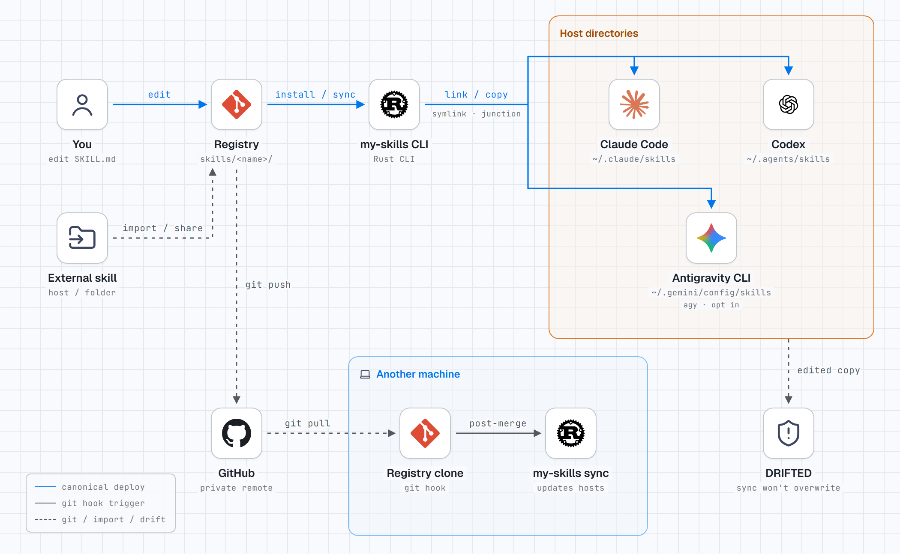

# my-skills

**직접 만든 에이전트 스킬을 한곳에 두고, 모든 코딩 에이전트에서 쓰세요.**

[English](README.md) | **한국어**

[](https://www.rust-lang.org/)
[](https://agentskills.io/specification)
[](LICENSE)

`my-skills`는 직접 만든 [Agent Skills](https://agentskills.io/specification)를
관리하는 작은 CLI입니다. 스킬은 폴더 하나(레지스트리, Git 저장소)에 모아 두고,
my-skills가 그 폴더를 Claude Code, Codex 같은 에이전트에 연결합니다. 스킬을 한 번
고치면 모든 에이전트에 바로 반영됩니다.

<picture>
  <source media="(prefers-color-scheme: dark)" srcset="docs/images/how-it-works-dark.png">
  
</picture>

- **스킬은 한곳에.** 스킬 하나는 `SKILL.md`가 든 폴더 하나입니다.
- **한 번 고치면 모두에 반영.** 에이전트에는 복사본이 아니라 원본으로 가는 링크가 걸립니다.
- **기기마다 같은 스킬.** 레지스트리를 비공개 Git 저장소에 올려 두면, 다른 기기에서는
  `git pull`만 하면 됩니다.

## CLI 설치

macOS·Linux:

```bash
curl -fsSL https://raw.githubusercontent.com/Seosiju/my-skills/main/scripts/install.sh -o my-skills-install.sh
sh ./my-skills-install.sh
```

Windows(PowerShell):

```powershell
Invoke-WebRequest -Uri 'https://raw.githubusercontent.com/Seosiju/my-skills/main/scripts/install.ps1' -OutFile '.\my-skills-install.ps1'
.\my-skills-install.ps1 -AddToPath
```

설치 스크립트는 최신 릴리스를 받아 SHA-256을 확인한 뒤 `~/.local/bin`(Windows는
`%LOCALAPPDATA%\Programs\my-skills\bin`)에 설치합니다. 설치한 뒤에는 터미널을 새로
열고 `my-skills --version`으로 확인하세요. 나중에 업데이트할 때는 `my-skills update`를
실행합니다.

## 시작하기

레지스트리를 새로 만듭니다. 위치를 물어보며(기본값 `~/my-agent-skills`), Git 저장소와
기본 스킬 몇 개를 함께 만들어 줍니다.

```bash
my-skills init-registry
my-skills install --dry-run   # 무엇을 연결할지 미리 보기
my-skills install             # 에이전트에 연결
```

다른 기기에 이미 레지스트리가 있다면 clone해서 연결합니다.

```bash
git clone <비공개-저장소-주소> ~/my-agent-skills
cd ~/my-agent-skills
my-skills bootstrap       # 이 기기의 에이전트에 스킬 연결
my-skills hooks install   # 앞으로 git pull 할 때마다 자동으로 맞춤
```

## 자주 하는 일

새 스킬 추가: 폴더와 `SKILL.md`를 만들고, 등록한 뒤 연결합니다.

```bash
cd ~/my-agent-skills
mkdir skills/my-skill                       # skills/my-skill/SKILL.md 작성
my-skills import skills/my-skill --enable   # 등록
my-skills install my-skill --dry-run
my-skills install my-skill --yes
```

지금 어떤 스킬이 어디에 연결돼 있는지 보기:

```bash
my-skills skills   # 스킬별로 에이전트마다 상태 표시
my-skills doctor   # 사용 중인 레지스트리와 문제가 있는지 확인
```

스킬을 끄고 반영하기:

```bash
my-skills disable my-skill
my-skills sync --yes
```

명령에 `--dry-run`을 붙이면 아무것도 바꾸지 않고 무엇을 할지만 보여 줍니다. 여러
에이전트에 한꺼번에 쓰는 명령은 `--yes`를 붙여야 실행됩니다.

## 여러 기기에서 같은 스킬 쓰기

레지스트리는 평범한 Git 저장소입니다. 비공개 원격 저장소에 push하고, 기기마다
clone한 폴더에서 `my-skills hooks install`을 한 번 실행하세요. 그러면:

- `git pull`만 하면 새 스킬은 연결되고, 바뀐 스킬은 갱신되고, 끈 스킬은 정리됩니다.
- 커밋할 때 스킬을 먼저 검사하므로, 깨진 스킬이 다른 기기로 넘어가지 않습니다.

## 지원하는 에이전트

| 에이전트 | 스킬 폴더 | 기본값 |
|---|---|---|
| Claude Code | `~/.claude/skills` | 켜짐 |
| Codex | `~/.agents/skills` | 켜짐 |
| Antigravity CLI(`agy`) | `~/.gemini/config/skills` | 꺼짐. `my-skills.toml`에서 켭니다 |
| Hermes | `~/.hermes/skills` | 꺼짐 |

Windows에서는 링크 대신 디렉터리 junction을 씁니다. Antigravity CLI는 junction을
인식하지 못하므로 Windows에서는 복사로 연결합니다([방법](docs/reference.md#antigravity-cli-agy)).

## 더 보기

- [참고 문서](docs/reference.md)(영문): 전체 명령, 링크와 복사, 레지스트리를 찾는 순서,
  안전장치, 비밀값 보관 위치
- [기여 안내](CONTRIBUTING.md)(영문): 소스 빌드와 테스트
- [변경 기록](CHANGELOG.md)

## 라이선스

[MIT](LICENSE)
