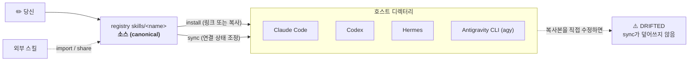

# my-skills

**Agent Skill을 한 번 작성하고, 모든 에이전트에서 사용하세요.**

_스킬을 위한 하나의 정규(canonical) 위치 — Claude Code·Codex·Hermes·Antigravity CLI 전반에 설치·동기화·공유._

[English](README.md) | **한국어**

[](https://www.rust-lang.org/)
[](https://agentskills.io/specification)
[](LICENSE)

`my-skills`는 당신의 [Agent Skills](https://agentskills.io/specification)를
한곳에 보관하고, 같은 스킬을 사용하는 모든 AI 코딩 에이전트에 설치하는 작은
CLI입니다. 링크된 스킬을 편집하면 각 호스트에서 변경 사항을 바로 볼 수 있습니다.
복사 모드에서는 `sync`가 원본 변경을 반영하고 로컬에서 수정된 복사본을 알려줍니다.

## 왜 쓰나요

- **한 번 작성, 어디서든 실행** — 같은 스킬이 Claude Code·Codex·Hermes·Antigravity CLI에서 동작합니다.
- **기본은 실시간 링크** — 새 registry는 링크를 사용하며, 복사 모드에서는 복사본을 교체하기 전에 로컬 편집을 감지합니다.
- **머신-로컬은 로컬에** — 비밀값·경로·계정은 정규 스킬이나 git에 절대 들어가지 않습니다.
- **CI 친화적** — `validate`, `install`, `sync --check`는 오류나 드리프트 시 비정상 종료코드를 반환합니다.

## Antigravity CLI (agy)

AGY는 **명시적으로 활성화하는 호스트**입니다. 기존 manifest가 agy를 생략하면
Claude Code·Codex·Hermes의 기본 대상은 유지됩니다. 새 레지스트리는 agy를
명시적으로 비활성화하며, 시드 스킬의 지원 목록에는 agy를 포함합니다. 활성화하려면:

```toml
[targets.agy]
enabled = true
scope = "user"
path = "~/.gemini/config/skills"
```

원하는 스킬의 `hosts`에도 `agy`를 넣으세요. `--host all`은 활성 대상만 선택하고,
`--host agy`를 명시하면 다른 호스트처럼 비활성 대상도 선택할 수 있습니다.
이행 전 검증·감사·dry-run을 거칩니다:

```bash
my-skills doctor --no-update-check
my-skills install <skill> --host agy --dry-run --json
my-skills install <skill> --host agy
my-skills skills --host agy --json
agy -p '/skills' --output-format json
```

프로젝트 경로는 `.agents/skills`입니다. 전역 경로의 일반 폴더·symlink 발견은
macOS의 **Antigravity CLI 1.2.16**과 **1.5.15**에서 확인했으며, 해당 `/skills` 검증은 모델
턴·토큰이 0이었습니다. Windows에서 `my-skills`는 기본적으로 디렉터리 junction으로
연결하는데, **Antigravity CLI 1.5.14**에서는 일반 폴더는 발견되지만 junction은
발견되지 않았습니다. Windows에서는 다른 호스트는 링크로 유지하면서
`my-skills.local.toml`의 `[targets.agy]`에 `install_mode = "copy"`를 설정할 수
있으며, Windows에서 `agy`가 유효 모드 `link`로 활성화되어 있거나 기록된 `agy`
링크 연결이 남아 있으면(`agy`가 비활성이거나 이미 `copy`로 설정된 경우 포함)
`my-skills doctor`가 경고를 출력합니다. Windows에서
`agy -p '/skills' --output-format json`은 Git Bash가 `/skills`를 Windows 경로로
바꾸므로 PowerShell에서 실행하세요. IDE나 모든 CLI 버전을 검증한 의미는 아닙니다.
공식 문서에는 `~/.gemini/antigravity-cli/skills`도 있으므로 다른 버전에서는 발견을
재확인하고 필요하면 대상 경로를 덮어쓰세요. 기존 미관리 스킬은 비교 후 발견 경로
밖에 백업하고 기존 충돌 검사 절차로 이행합니다. 공개 Hermes 지원은 유지하며 개인
레지스트리에서 필요에 따라 비활성화할 수 있습니다.

## 어떻게 동작하나요

### 하나의 도구, 두 개의 repo

tool repo(이 저장소)는 설치하는 대상입니다. registry(기본값
`~/my-agent-skills`, `init-registry`가 생성)는 실제 스킬이 사는 곳입니다.
소스 체크아웃에는 CLI와 공개 시드 파일이 들어 있습니다. registry는 별도 디렉터리에서 관리합니다.

스킬은 registry의 `skills/<name>/` 아래 디렉터리이며, YAML
frontmatter(`name`, `description`)를 가진 `SKILL.md`를 포함합니다 —
[Agent Skills](https://agentskills.io/specification) 표준입니다. registry의
`skills/` 디렉터리가 **정규(canonical)** 진실의 원천입니다.

각 에이전트(Claude Code, Codex, Hermes, Antigravity CLI)는 **호스트**입니다.
`install`은 링크나 복사로 정규 스킬을 호스트에 연결합니다. `sync`는 매니페스트에
맞춰 연결을 조정하고, 더 이상 필요한 상태가 아닌 관리 설치본은 기본적으로
제거합니다. 로컬에서 수정된 복사본은 덮어쓰지 않습니다.

registry의 `skills/`에는 정규 스킬이 있습니다. 호스트 디렉터리에는 에이전트가
발견할 수 있는 정규 스킬의 링크나 복사본이 있습니다.



## CLI 설치

설치 스크립트는 GitHub Releases에서 최신 안정 버전의 바이너리를 내려받고
`SHA256SUMS`로 아카이브를 검증합니다.

### macOS와 Linux

Apple silicon 또는 Intel Mac과 x86-64 GNU/Linux에서 실행합니다.

```bash
curl -fsSL https://raw.githubusercontent.com/Seosiju/my-skills/main/scripts/install.sh -o my-skills-install.sh
sh ./my-skills-install.sh
```

기본 설치 디렉터리는 `$HOME/.local/bin`입니다. 필요하면 PATH에 추가한 뒤
`my-skills --version`을 실행합니다.

### Windows

x86-64 Windows의 PowerShell에서 실행합니다.

```powershell
Invoke-WebRequest -Uri 'https://raw.githubusercontent.com/Seosiju/my-skills/main/scripts/install.ps1' -OutFile '.\my-skills-install.ps1'
.\my-skills-install.ps1 -AddToPath
my-skills --version
```

기본 설치 디렉터리는 `%LOCALAPPDATA%\Programs\my-skills\bin`입니다.
`-AddToPath`는 사용자 PATH와 현재 PowerShell 세션의 PATH에 이 경로를 추가합니다.

특정 릴리스를 설치하려면 스크립트 실행 전에 `MY_SKILLS_VERSION`에 해당 태그를
지정합니다. 기존 `my-skills`가 있다면 PATH에서 새 실행 파일이 선택되는지 확인합니다.
소스 빌드 방법은 [CONTRIBUTING.md](CONTRIBUTING.md)를 참고하세요.

이미 열려 있던 터미널과 에이전트 세션은 예전 PATH를 그대로 씁니다. 설치한 뒤에는
새로 열어서 쓰세요. 특히 registry에서 Git을 실행하기 전에 새로 열어야 hook이 예전
`my-skills`를 실행하지 않습니다.

## 빠른 시작

CLI를 설치한 뒤 tool repo 밖에서 다음 명령을 실행합니다.

```bash
my-skills init-registry        # 위치를 묻고, 기본값은 ~/my-agent-skills
my-skills doctor               # Registry 줄이 내 registry를 가리키는지 확인
my-skills install --dry-run    # seed된 기본 스킬 설치 계획 미리 보기
my-skills install              # 활성 스킬을 에이전트에 배포
```

`init-registry`는 public-safe 기본 스킬을 seed하고, 이 registry를 active root로
기록하며, `--no-git`을 주지 않으면 git도 초기화합니다. 이후 명령은 어느 디렉터리에서나
동작합니다:

```bash
my-skills doctor
my-skills skills --json
```

`skills`는 모든 스킬과 호스트별 설치 위치를 보여줍니다:

```text
SKILL             ENABLED  CLAUDE   CODEX    HERMES
----------------  -------  -------  -------  -------
cli-inventory     yes      fresh    fresh    missing
my-skills         yes      fresh    fresh    fresh
```

## CLI 업데이트

Python v0.4.2에서 `my-skills update`를 실행하면 안정 v1 릴리스로 이전하는 데
필요한 설치 스크립트 링크가 나옵니다.
[변경 기록의 v0.4.2 항목](CHANGELOG.md#042---2026-11-23)을 참고하세요.

Rust CLI의 `my-skills doctor`는 더 최신 안정 v1 릴리스가 있는지 확인합니다.
`my-skills update`로 설치할 수 있습니다. 업데이트 명령은 아카이브 체크섬을
검증하고 실행 중인 CLI 파일을 교체합니다.

```bash
my-skills doctor
my-skills update
```

`--check`는 업데이트 여부를 확인합니다. `--dry-run`은 더 최신 릴리스가 있을 때
다운로드와 실행 파일 교체 계획을 보여 줍니다.

```bash
my-skills update --check
my-skills update --dry-run
```

`--channel main`은 프리릴리스를 포함해 게시된 릴리스 중 버전이 가장 높은 것을
선택합니다.

```bash
my-skills update --channel main
```

## 공개 CLI, 비공개 registry

이 repo는 두 역할을 합니다:

```text
github.com/Seosiju/my-skills
  공개 CLI 패키지
  공개 가능한 starter skills
  docs, tests, release automation

각자의 private registry
  my-skills.toml
  skills/<name>/SKILL.md
  개인/회사 맥락이 들어간 비공개 스킬

머신-로컬 data path
  실제 config.json 파일
  계정, 토큰, 메모리, local state
```

공개 repo는 도구 설치에 사용합니다. canonical skill에 개인·회사·머신별 맥락이
들어간다면 별도 private registry를 사용하세요. secret은 public repo와 private
repo 모두에 넣지 말고 `my-skills data-path <skill>` 아래에 둡니다.

private registry를 만듭니다. 경로를 생략하면 기본 위치는 `~/my-agent-skills`이며,
`init-registry`는 기본 public-safe 스킬을 seed하고 active root를 기록한 뒤
`git init`을 실행합니다:

```bash
my-skills init-registry
```

scaffold 구조:

```text
my-agent-skills/
├── my-skills.toml        # 호스트, 기본값, seed된 [skills.<name>] 항목
├── skills/               # seed된 기본 스킬을 포함한 canonical skills
├── .gitignore            # local override 무시
└── README.md             # private registry 운영 메모
```

빈 registry가 필요하면 `--no-defaults`를, git 없는 plain folder를 원하면 `--no-git`을
사용하세요. 다른 기기에서는 기존 registry를 복제하고 그 안에서
`my-skills bootstrap`을 실행해 호스트 연결을 조정합니다. Git hook을 설정하려면
`my-skills hooks install`을 별도로 실행합니다([모든 기기를 맞춰 두기](#모든-기기를-맞춰-두기) 참고).

## 명령이 registry를 찾는 순서

대부분의 명령은 다음 순서로 registry를 찾습니다:

1. `MY_SKILLS_ROOT` 환경 변수. 한 번의 명령만 다른 registry로 실행할 때 씁니다.
2. 현재 디렉터리나 부모 디렉터리의 `my-skills.toml`. 이 호출에만 적용됩니다.
3. `init-registry` 또는 `set-root`가 기록한 cached active root.

다른 valid active root가 cache되어 있는 상태에서 또 다른 registry 안에서 명령을
실행하면, 그 명령은 현재 디렉터리를 사용하고 stderr에 안내를 출력합니다. active root를
조용히 바꾸지는 않습니다. 영구적으로 바꾸려면 다음을 실행하세요:

```bash
my-skills set-root /path/to/your/registry
my-skills doctor
```

아직 active root가 없는 머신에서는 편의를 위해 현재 디렉터리에서 처음 발견한
registry를 기록할 수 있습니다. `--dry-run`은 기록하지 않고 `would remember <path> as the active registry`라고
미리 보여 줍니다. 기여자용 clone에도 패키징과 테스트를 위한 seed
`skills/` 및 `my-skills.toml`이 있으므로, 실제 스킬을 변경하기 전에는
`my-skills doctor`의 `Registry:` 줄을 확인하세요.

첫 private skill을 추가합니다:

```bash
mkdir -p skills/my-private-skill
$EDITOR skills/my-private-skill/SKILL.md
```

그리고 `my-skills.toml`에 등록합니다:

```toml
[skills.my-private-skill]
enabled = true
hosts = ["claude", "codex", "hermes", "agy"]
```

registry를 검증하고 새 스킬의 설치 계획을 검토한 뒤 여러 호스트에 쓰기를
확정합니다.

```bash
my-skills validate
my-skills audit --all --json
my-skills install my-private-skill --dry-run
my-skills install my-private-skill --yes
```

## 모든 기기를 맞춰 두기

registry는 Git 저장소입니다. 비공개 원격 저장소에 push하고 기기마다 clone한 뒤,
clone마다 한 번 Git hook을 설치합니다:

```bash
my-skills hooks install
my-skills hooks status
```

- `pre-commit`은 커밋에 들어가는 스킬과 manifest 변경을 검증하고, 깨진 스킬은
  커밋을 막습니다.
- `post-merge`, `post-rewrite`, `post-checkout`(브랜치 전환)은 `sync`를 실행합니다.
  그래서 `git pull` 한 번이면 그 기기의 모든 호스트에 새 스킬이 연결되고, 복사본이
  갱신되고, 끈 스킬은 제거됩니다.
- link로 연결하면 원본 스킬을 고친 내용이 같은 기기의 모든 에이전트에 바로
  보입니다. 다른 기기와 나누려면 커밋하고 push합니다.

hook은 PATH의 `my-skills`를 쓰고, 없으면 `hooks install` 때 기록한 실행 파일
경로를 씁니다. 실행 파일을 옮겼다면 `my-skills hooks install`을 다시 실행하세요.
hook 안의 sync가 실패하면 경고만 출력하고 Git 명령은 실패시키지 않으므로, pull
결과가 이상하면 `my-skills status`로 확인하세요.

## 포함된 스킬

| 스킬 | 하는 일 |
|------|---------|
| `cli-inventory` | 이 머신에 설치된 CLI 도구를 발견(PATH + Homebrew/npm/pipx/cargo/gem/pip)해 머신-로컬 인벤토리로 기록하고 빠르게 다시 읽기. |
| `my-skills` | 카탈로그·share·install·sync 워크플로를 CLI로 안내하는 에이전트용 스킬. |
| `my-jira` | 머신-로컬 설정 템플릿을 포함한 Jira/Atlassian 부트스트랩 스킬. 기본값은 비활성. |

`personal-profile`은 더 이상 기본 포함되지 않습니다. 기본 목록은 새로 초기화하는
registry에 적용됩니다. CLI 패키지 업데이트는 별도 개인 registry의 스킬·호스트
설치본·머신-로컬 데이터를 삭제하지 않습니다. 이 tool repo를 pull하면 포함된 seed
원본은 갱신되므로, 개인 스킬은 별도 registry에서 관리하세요.

registry에 `personal-profile`이 아직 등록돼 있으면 먼저 비활성화한 뒤 호스트
설치본을 삭제하세요. 그래야 이후 `install`이나 `sync`가 다시 설치하지 않습니다:

```bash
my-skills disable personal-profile
my-skills uninstall personal-profile --host <host>
```

이미 등록을 지웠다면 `uninstall`만 실행하세요. 설치 상태에 기록된 기존 관리
설치본은 스킬 등록 없이도 삭제할 수 있습니다.

## 일상 명령어

```bash
# 무엇이 있고 어디에 설치됐는지 본다.
my-skills skills              # 에이전트/UI용은 --json 추가
my-skills status              # 스킬별·호스트별 설치 상태

# 설치 / 갱신.
my-skills install --dry-run   # 호스트 변경 계획 미리 보기
my-skills install             # 활성 스킬 -> 활성 호스트
my-skills install cli-inventory --host claude
my-skills install cli-inventory --host all --yes  # 명시적인 다중 호스트 쓰기
my-skills sync --dry-run      # 제거를 포함한 변경 계획 미리 보기
my-skills sync --yes          # 검토한 계획을 활성 호스트에 적용
my-skills sync --check        # 연결에 변경이나 차단이 있으면 비정상 종료코드

# 관리되는 설치본 제거 (기록된 대상만).
my-skills uninstall cli-inventory --host claude

# 매니페스트에서 스킬 켜기/끄기.
my-skills enable cli-inventory
my-skills disable cli-inventory
```

### 이미 작성한 스킬 가져오기

```bash
# 외부 스킬 디렉터리를 정규 skills/로 가져온다.
my-skills import ~/.hermes/skills/cli-inventory
my-skills enable cli-inventory
my-skills install cli-inventory --host <host>

# 또는 가져오면서 바로 활성 상태로 등록한다.
my-skills import ~/.hermes/skills/cli-inventory --enable

# 또는 registry에 아직 없는 Claude Code 스킬을 가져온다.
my-skills share --from claude --plan --json
my-skills share --from claude example-skill --enable
my-skills sync example-skill --dry-run
my-skills sync example-skill --yes
```

`import`는 스킬을 `my-skills.toml`에 자동 등록합니다. 기본 등록 상태는
disabled이므로 설치 전에 `--enable`을 붙이거나 `my-skills enable <skill>`을
실행합니다. audit와 복사 경계가 같은 디렉터리 트리로 유지되도록, symlink를
포함한 import 소스는 차단됩니다.

### 스킬을 실시간으로 개발하기

```bash
# 호스트 디렉터리를 정규 스킬에 연결해 편집 사항을 바로 반영한다.
my-skills install cli-inventory --host claude --mode link
```

링크 모드는 Unix에서 심볼릭 링크를, Windows에서는 우선 junction을 사용합니다.
`uninstall`은 관리 링크를 제거하고 registry의 원본을 보존합니다. `my-skills.toml`이나
`my-skills.local.toml`의 `[targets.<host>]` 아래에 `install_mode = "link" | "copy"`를
호스트별로 지정할 수 있습니다(새 연결의 우선순위: `install --mode` >
`[targets.<host>] install_mode` > `[defaults] install_mode`). 기존 설치본은 기록된
모드를 유지합니다. 기존 복사본을 링크로 전환하려면 `my-skills convert --to link`에
`--dry-run`을 붙여 미리 봅니다. `convert --to <mode> --host all`은 명시된
`[targets.<host>] install_mode`가 `--to`와 다른 호스트를 건너뛰며, `--host <name>`을
직접 지정하면 요청대로 전환합니다.

## 안전성은 이렇게 지켜집니다

- **기본은 링크.** 새 복사본을 만들려면 `my-skills.toml` 또는 `my-skills.local.toml`의
  `[defaults]`나 `[targets.<host>]`에 `install_mode = "copy"`를 설정하거나
  `install`에 `--mode copy`를 붙입니다.
- **다중 호스트 쓰기는 확인이 필요합니다.** 여러 호스트에서 `install` 또는
  `sync`에 `--yes`를 붙이기 전에 dry-run 계획을 검토합니다. 기본 경로에 내장
  시드 스킬만 설치하는 인자 없는 `install`은 예외입니다.
- **충돌 = 차단.** 이미 존재하는 비관리 대상은 절대 덮어쓰지 않습니다.
- **드리프트 보호.** 로컬에서 편집된 복사본은 덮어쓰지 않고 보고합니다.
- **원자적 쓰기.** 설치는 임시 디렉터리에 준비한 뒤 제자리로 교체하며, 실패 시 롤백합니다.
  설치 기록(state) 저장이 실패해도 되돌리므로, 원인을 없앤 뒤 같은 명령을 다시 실행하면 됩니다.

설치 state는 머신-로컬(`$XDG_STATE_HOME` 또는 `~/.local/state/my-skills/`)이며
절대 커밋되지 않습니다.

`sync`와 `status`는 각 (스킬, 호스트)를 분류해 쓰기 작업이 무엇을 할지 항상 알 수 있게 합니다:

| 상태 | 의미 |
|------|------|
| `FRESH` | 설치본이 정규본과 일치 |
| `STALE` | 복사본을 설치한 뒤 정규본이 변경됨 |
| `DRIFTED` | 설치본이 로컬에서 편집됨; `sync`가 건드리지 않음 |
| `CONFLICT` | 양쪽 모두 변경됨 — 자동 병합 불가 |
| `MISSING` | 등록됐지만 설치되지 않음 |
| `UNMANAGED` | 설치 위치는 존재하지만 관리 기록이 없음 |
| `BROKEN` | 관리 링크가 사라진 정규 디렉터리를 가리킴 |
| `UNSUPPORTED` | 스킬의 호스트 목록에 이 호스트가 포함되지 않음 |

`sync`가 매니페스트에 따라 스킬을 연결할 때 `DRIFTED`, `CONFLICT`,
`UNMANAGED`, `BROKEN`은 해당 연결을 차단하며 비정상 종료코드를 반환합니다.

### 머신-로컬 데이터

정규 스킬은 머신별 데이터를 절대 저장하지 않습니다. 실제 로컬 데이터가 필요한
스킬(예: `cli-inventory` 스캔 결과)은 대신 모든 호스트가 공유하는 단일 데이터
루트를 읽고 씁니다:

```bash
my-skills data-path cli-inventory          # 경로 해석
my-skills data-path cli-inventory --create # 그리고 생성
```

데이터 루트는 머신-로컬이며 절대 커밋되지 않습니다. 비공개 설정이 필요한 스킬도
같은 패턴을 씁니다. `skills/<name>/`에는 `config.example.json`만 두고, 실제
`config.json`은 해당 스킬의 데이터 경로 아래에 만듭니다.

```bash
config_dir="$(my-skills data-path my-jira --create)"
cp skills/my-jira/config.example.json "$config_dir/config.json"
$EDITOR "$config_dir/config.json"
```

머신별 override는 `my-skills.local.toml` 또는 `local/`에 둡니다. 둘 다 git에서
무시됩니다. 호스트 설치본, state 파일, 계정 ID, 토큰, 개인 메모리는 커밋하지 마세요.

## 구조

### Repository layout (CLI 프로젝트)

```text
my-skills.toml            # 이 CLI 프로젝트의 개발/테스트 manifest
skills/<name>/SKILL.md    # 바이너리에 포함되는 공개 시드 원본
Cargo.toml                # Rust 패키지 매니페스트
src/                      # Rust 라이브러리와 CLI
tests/                    # 단위 + 픽스처 기반 테스트
```

이 저장소의 `skills/` 디렉터리는 seed source이자 tests/CI용 dev fixture입니다.
사용자의 registry가 아닙니다.

### 내 registry layout

```text
my-agent-skills/
├── my-skills.toml
├── skills/<name>/SKILL.md
├── .gitignore
└── README.md
```

`install`은 기본적으로 활성 스킬을 연결합니다. 인자 없는 `sync`는 비활성 스킬과
등록이 해제된 스킬도 확인해 관리 설치본을 제거합니다. 제거를 건너뛰려면
`sync --no-prune`을 사용합니다. `install`이나 `sync`에 `--all`을 붙이면
비활성 스킬도 연결할 수 있습니다.

## 테스트

```bash
cargo fmt --all --check
cargo clippy --all-targets -- -D warnings
cargo test --all-targets
cargo build --release
```

작업 트리에서 CLI를 실행할 수 있습니다. 기본 동작을 확인할 때는 테스트용 registry와
호스트 경로를 사용합니다.

```bash
cargo run -- doctor --no-update-check
cargo run -- skills --json
cargo run -- bootstrap --dry-run
cargo run -- install my-skills --host hermes --dry-run
```

GitHub Release 태그를 만들기 전
[docs/release-checklist.md](docs/release-checklist.md)를 확인하세요.

## 라이선스

[MIT](LICENSE)
