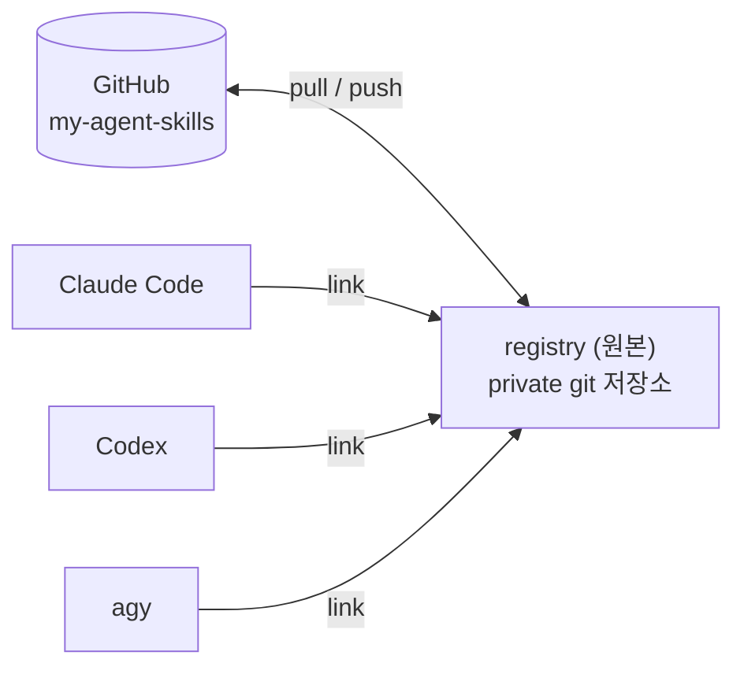
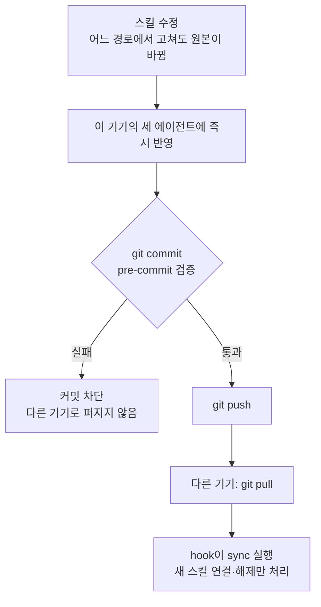
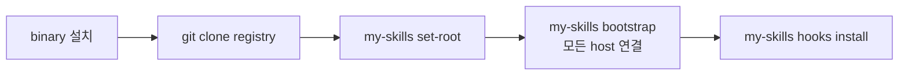
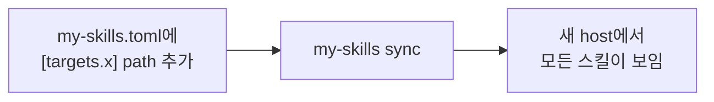

# Skill Drive 구조 전환 및 Rust v1 재작성 스펙

> 작성일: 2026-11-23
> 상태: 확정 (Q1, Q3, Q5~Q7은 구현 중 결정)
> 브랜치: `dev`
> 대상 저장소: github.com/Seosiju/my-skills (tool repo)
> 함께 바뀌는 저장소: 사용자 개인 레지스트리 `my-agent-skills` (3단계에서만)
> **진행 현황과 작업 인계: docs/2026-11-23-skill-drive-v1-status-and-handoff.md** (남은 작업은 그 문서 §7 기준)
> 관련 문서: docs/2026-06-25-cross-agent-skill-registry-plan.md (copy/link 최초 결정),
> docs/2026-07-09-cli-update-detection-and-command-plan.md (업데이트 명령)

**제품 정의:** my-skills는 **개인 스킬 드라이브**다. 스킬 원본은 registry 한 곳에만 있고,
모든 기기의 모든 에이전트가 같은 스킬을 본다. 어디서 고쳐도 원본이 고쳐지고, 지우거나 끄면
모든 곳에서 사라진다. 각 에이전트의 스킬 폴더에는 설치본이 아니라 원본을 가리키는 바로가기(link)만 둔다.
이 문서의 모든 결정은 이 정의를 기준으로 판단한다.

## 0. 용어

| 용어 | 의미 |
|---|---|
| **tool repo** | 이 저장소. 범용 CLI `my-skills`의 소스·seed·문서·테스트 |
| **CLI** | 설치되어 `PATH`에서 실행되는 `my-skills` 실행 파일 |
| **registry** | 사용자의 스킬 원본 저장소 (private git 저장소) |
| **canonical** | registry의 `skills/<name>/`. 스킬의 유일한 원본 |
| **host** | 스킬을 읽는 에이전트. Claude Code(`claude`), Codex(`codex`), Antigravity CLI(`agy`), Hermes(`hermes`, 비활성) |
| **host directory** | host가 스킬을 발견하는 폴더. 예: `~/.claude/skills` |
| **연결(connection)** | host directory 안의 `<name>` 항목. canonical을 보이게 하는 수단 |
| **link 연결** | canonical을 가리키는 디렉터리 링크. macOS/Linux는 symlink, Windows는 junction(실패 시 symlink) |
| **copy 연결** | canonical을 복사한 실제 폴더 |
| **managed** | state에 기록되어 my-skills가 소유하는 연결. 기록 없는 항목은 unmanaged이며 절대 건드리지 않는다 |
| **reconcile** | host directory를 manifest가 원하는 상태와 일치시키는 동작 (생성·갱신·해제) |

## 1. 배경

현재(v0.4.1, Python)는 canonical을 host directory에 **복사**하고, canonical을 고칠 때마다
`my-skills sync`로 다시 복사한다. 이 사용자의 실제 상태(2026-11-23):

- 모든 연결이 copy다. 비활성화한 host(hermes)의 기록도 남아 있다.
- registry 수정 절차(`my-agent-skills/AGENTS.md`)는 "원본 수정 → 검증 → **동기화** → 일치 확인 → 커밋·push" 5단계다.
- registry에는 git hook이 없다. 검증은 에이전트가 절차를 직접 따르는 방식에만 의존한다.
- 사용자는 **macOS와 Windows 두 컴퓨터**에서 **Claude·Codex·agy 세 에이전트를 모두** 쓴다.

### 1.1 문제

1. **같은 기기에서도 바로 반영되지 않는다.** 수정할 때마다 sync를 해야 하고, 잊으면 에이전트가 예전 스킬을 쓴다.
2. **어디서 고쳤는지에 따라 결과가 달라진다.** host 경로로 고치면 drift가 되어 다음 sync가 막히거나, 고친 내용이 덮어써진다.
3. **기기 간 반영을 손으로 한다.** git pull/push와 sync를 기기마다 직접 실행해야 한다.
4. **Windows 첫 설치가 무겁다.** CLI를 돌리려면 Python과 uv를 먼저 준비해야 한다.
5. **링크를 하나의 함수로 판별하지 않는다.** 코드 곳곳에서 `Path.is_symlink()`만 쓰는데, Windows junction은 이 함수에서 False가 나온다. 이 상태로 junction을 쓰면 uninstall이 연결을 일반 폴더로 보고 `rmtree`해서 **canonical을 지울 수 있다** (`planner.py:23`, `installer.py:124`).
6. **설정값 하나가 적용되지 않는다.** manifest의 `[defaults] install_mode`를 읽기만 하고 쓰지 않는다. CLI의 `--mode` 기본값이 `"copy"`로 고정돼 있다 (`cli.py:90`, `cli.py:135`).
7. **sync가 해제를 하지 않는다.** 비활성화하거나 등록을 해제한 스킬의 연결이 sync 뒤에도 남는다 (`cmd_sync`가 `plan_install`만 호출).

## 2. 목표와 비목표

### 2.1 목표

| ID | 목표 | 완료 판단 |
|---|---|---|
| G1 | **드라이브 모델**: canonical 하나를 모든 host가 같은 내용으로 본다 | canonical 수정이 sync 없이 세 host에 반영된다 |
| G2 | 어디서 고쳐도 canonical이 고쳐진다 | host 경로로 수정해도 drift가 생기지 않는다 |
| G3 | 새 host 연결은 설정 한 줄로 끝난다 | `[targets.<x>] path=...` 추가 후 `sync` 한 번이면 된다 |
| G4 | 새 기기 준비는 명령 몇 개로 끝난다 | 런타임 설치 없이 binary 하나 + clone + `bootstrap` |
| G5 | macOS·Windows 두 기기에서 세 host가 모두 동작한다 | 각 OS 실기기 체크리스트(§11, §12)를 통과한다 |
| G6 | canonical을 절대 잃지 않는다 | §4 안전 불변식을 OS별 테스트로 보장한다 |
| G7 | Rust 단일 binary로 제공한다 | GitHub Releases에 OS별 binary가 올라간다 |

### 2.2 비목표

- 여러 사용자의 동시 편집, 충돌 자동 병합. 사용자는 한 명이다.
- git을 대체하는 동기화 엔진. 기기 간 반영은 git으로 한다.
- 스킬 마켓플레이스·공개 배포. `npx skills` 같은 공개 스킬 CLI의 역할이다.
- Hermes 재활성화. host 정의는 유지하되 기본 비활성이다.
- unmanaged 스킬(gstack, 앱 동봉 스킬 등)의 관리.
- 자동 pull 스케줄러. 4단계에서 별도 스펙으로 다룬다.

## 3. 목표 구조

### 3.1 역할 분리

- **registry(`my-agent-skills`)**: 스킬 원본과 운영 정책(연결 방식, hook 사용 여부, 활성 host)을 소유한다.
- **CLI(`my-skills`)**: 범용 연결기다. 연결·검증·hook 설치·상태 확인 기능만 제공하고, 특정 사용자 전용 동작은 넣지 않는다. canonical을 소유하지 않는다.

### 3.2 기기 하나의 구조



원본은 registry 한 곳에만 있다. 세 에이전트의 스킬 폴더에는 원본을 가리키는 link만 있다.

| 무엇 | 어디에 | git |
|---|---|---|
| 스킬 원본, `my-skills.toml` | registry | 포함 |
| 검증·sync hook | registry의 `.git/hooks` | 제외 (기기마다 `hooks install`) |
| link | `~/.claude/skills`, `~/.agents/skills`, `~/.gemini/config/skills` | 제외 |
| 계정 설정·비밀정보 | data dir (§8.4) | 제외 |
| 이 기기의 연결 기록 | `state.json` (§8.3) | 제외 |

link 종류: macOS/Linux는 symlink, Windows는 junction → symlink → copy(경고) 순서로 시도한다(D1).

### 3.3 수정 흐름



내용 변경은 link라서 pull만 하면 바로 반영된다. sync는 스킬 추가·삭제 같은 구조 변경만 맡는다.

### 3.4 새 기기, 새 host





기기별로만 쓰는 host는 `my-skills.toml` 대신 git에서 제외되는 `my-skills.local.toml`에 추가한다.

## 4. 안전 불변식

모든 구현은 아래 조건을 지켜야 하고, 조건마다 OS별 자동 테스트가 있어야 한다.

| ID | 불변식 |
|---|---|
| I1 | install·sync·uninstall·convert·reconcile은 **canonical 아래의 파일을 만들거나 고치거나 지우지 않는다**. |
| I2 | 연결을 지울 때는 **링크 자체만** 지운다. 링크(symlink, junction)를 따라 들어가는 재귀 삭제는 금지한다. 재귀 삭제 전에는 반드시 `symlink_metadata`로 reparse point나 symlink가 아닌지 확인한다. |
| I3 | unmanaged 항목(state에 기록이 없는 항목)은 읽기만 하고 절대 바꾸지 않는다. |
| I4 | 대체 동작은 조용히 하지 않는다. link를 만들지 못해 copy로 설치하면 출력에 `[copy fallback]`과 이유를 남기고, state에도 기록한다. |
| I5 | copy 연결을 덮어쓰거나 지우기 전에 host 쪽 수정 여부(hash)를 확인한다. 수정됐으면(DRIFTED, CONFLICT) 막는다. |
| I6 | 파일시스템 쓰기는 원자적이거나 되돌릴 수 있어야 한다 (staging 후 rename, backup 후 교체). |
| I7 | 비활성 target의 기록과 설치본은 reconcile 대상이 아니다. 별도 요청이 있을 때만 정리한다. |
| I8 | 비밀정보는 registry 밖의 data dir에만 둔다. CLI는 data dir 내용을 registry로 복사하지 않는다. |

## 5. 핵심 결정

### D1. 기본 연결 방식은 link

- CLI 기본값을 `copy`에서 `link`로 바꾼다. manifest `[defaults] install_mode`는 `"link" | "copy"`이고, 값이 없으면 `"link"`다.
- `[targets.<host>]`에도 선택 항목 `install_mode = "link" | "copy"`를 둘 수 있다(`my-skills.toml` 및 `my-skills.local.toml`, 기기별 오버레이 우선). 잘못된 값은 manifest 검증 오류로 실패한다.
- 새 연결의 우선순위: CLI `--mode` > `[targets.<host>] install_mode` (`my-skills.local.toml` > `my-skills.toml`) > `[defaults] install_mode` (`my-skills.local.toml` > `my-skills.toml`) > 기본값 `link` 순.
- link를 만드는 순서:
  - macOS/Linux: symlink. 실패하면 copy로 설치한다(I4).
  - Windows: junction, 실패하면 symlink, 그것도 실패하면 copy(I4).
- copy는 사용자가 직접 고르는 선택지로 남는다. 예: 특정 시점의 스냅샷을 고정하고 싶을 때, 또는 Windows에서 junction을 발견하지 못하는 host(`agy`)만 `[targets.agy] install_mode = "copy"`로 둘 때.
- 이미 있는 연결은 기존 방식을 유지한다. 방식을 바꾸는 건 `convert`(§6.6)만 한다.

**근거:** copy를 기본으로 둔 이유는 동기화 시점의 검증 관문과 Windows 권한 문제였다
(2026-06-25 계획 결정 2). 검증 관문은 D2에서 commit 시점으로 옮기고, 권한 문제는
junction(관리자 권한 불필요)과 경고를 남기는 copy 대체 동작으로 해결한다.

### D2. 검증 관문은 registry의 git pre-commit

- 링크로 연결하면 canonical 수정이 바로 노출되므로, sync 시점의 검증은 의미가 없다.
- 대신 고치다 만 상태가 **다른 기기로 퍼지는 것**을 막는다. 검증은 commit 시점에서 한다.
- hook은 CLI가 설치 기능만 제공하고(§6.7), 실제 설치 여부는 registry가 정한다.
- `git commit --no-verify`로 우회하는 것은 사용자 선택으로 허용한다.

### D3. sync는 reconcile한다

- 원하는 상태: skill이 활성이고, target이 활성이고, host가 `skill.hosts`에 포함된 경우(`hosts`가 비어 있으면 모든 host).
- 원하는 상태인데 연결이 없으면 생성한다. 원하는 상태가 아닌데 managed 연결이 있으면 해제한다.
- 해제할 때도 I2, I3, I5, I7을 지킨다. 특히 **비활성 target은 건드리지 않는다**. 실제로 비활성화한 hermes의 기록과 설치본이 그대로 보존돼야 한다.
- 출력과 `--dry-run`에 생성·해제 목록을 보여 준다. `--no-prune`을 주면 해제를 건너뛴다.
- **해제가 기본이다 (Q4 결정).** 드라이브에서 지운 파일이 모든 기기에서 사라지는 것과 같다.
  link 해제는 원본을 건드리지 않으므로, 실수로 꺼도 다시 enable하고 sync하면 돌아온다.
- **sync의 대상은 항상 등록된 스킬 전체다** (2026-11-23 구현 중 결정). v0.4.1처럼 활성 스킬만
  대상으로 하면 비활성화한 스킬의 link를 해제할 수 없기 때문이다. 스킬 이름을 주면 그 스킬만 본다.
  `--all`은 v0.4.1과 같은 뜻으로 남긴다. 비활성 스킬도 연결한다.

### D4. registry는 기본 브랜치 하나로 쓴다

- link로 연결하면 registry 작업 트리가 그대로 노출되므로, 브랜치를 전환하면 모든 host의 스킬이 바뀐다.
- CLI는 브랜치 전환을 막지 않는다. 대신 `doctor`와 `status`가 기본 브랜치가 아니거나, rebase·merge 중이거나, 충돌 표시가 남아 있으면 경고한다.
- post-checkout hook이 브랜치 전환 뒤 연결 구조를 맞춘다.

### D5. Rust로 재작성하고 Python 0.4.x는 동결한다

- 새 구조(D1~D4)는 **Python에 구현하지 않는다**. Rust v1에서 바로 구현해 같은 일을 두 번 하지 않는다.
- Python 0.4.x는 보안·치명 버그만 고친다. 문제 6(`install_mode` 무시)은 Python에서 고치지 않고 Rust에서 해결한다.
- Rust v1이 0.4.1 명령 전체를 같은 동작으로 갖추면(§9 2단계 완료 기준) 기본 배포를 Rust로 바꾼다.

**근거:**
- binary 하나로 배포하면 Windows 첫 설치에서 Python과 uv를 준비하지 않아도 된다(G4).
- 링크·junction·reparse point를 OS별로 정확히 다루기에 Rust 표준 라이브러리와 타입 시스템이 유리하다(G6).
- 모든 commit과 merge에서 hook으로 실행되므로 시작 시간이 짧아야 한다.

### D6. 데이터 형식은 호환된다

- Rust v1은 v0.4.1의 `my-skills.toml`(schema 1), `state.json`(schema 1), active root 설정, data dir을 **그대로** 읽는다.
- 디렉터리 hash 알고리즘을 **바이트 단위로 같게** 구현한다(§8.5). 그래야 기존 copy 기록을 다시 설치하지 않고도 FRESH·STALE을 판정할 수 있다.
- 새 필드는 모두 선택 사항이다. Python 0.4.x는 모르는 필드를 읽을 때 무시하지만, **저장할 때는 지운다**. 그래서 두 버전이 공존하는 동안 Rust는 새 필드가 없어도 파일시스템을 보고 상태를 추론해야 한다.

## 6. 기능 스펙

여기서는 바뀌거나 새로 생기는 동작만 자세히 적는다. 나머지 명령은 §6.9 동작 유지 목록을 따른다.
공통 규칙:
- 모든 쓰기 명령은 `--dry-run`을 지원한다.
- 여러 host에 쓰는 명령은 기존처럼 확인(`--yes`)을 요구한다.
- `--json` 출력은 0.4.1의 키를 유지하고 새 키만 추가한다.

### 6.1 링크 판별 (`link` 모듈, 모든 명령이 공통으로 사용)

| 함수 | 동작 |
|---|---|
| `link_kind(path)` | `symlink_metadata` 기준으로 `Symlink`, `Junction`, `Dir`, `File`, `Missing`을 돌려준다. 대상을 따라가지 않는다. |
| `link_target(path)` | symlink는 `read_link`, junction은 reparse 대상을 읽는다. 상대 경로는 링크 위치 기준으로 해석한다. |
| `is_managed_link(dest, canonical)` | `link_kind`가 Symlink나 Junction이고, 정규화한 대상이 정규화한 canonical과 같으면 true. |
| `create_link(dest, canonical)` | D1 순서로 시도하고, 성공한 `LinkKind`나 copy 대체 사유를 돌려준다. 대상 경로는 절대 경로로 만든다. |
| `remove_link(dest)` | Symlink는 링크만 지운다(unlink). Junction은 `remove_dir`로 reparse point만 지운다. 링크가 아니면 오류를 낸다. |

경로 비교: 대소문자를 구분하지 않는 파일시스템(Windows, macOS 기본)에서는 정규화한 경로로 비교한다.
Windows에서는 `\\?\` 접두어를 제거하고 비교한다.

### 6.2 연결 상태

| 상태 | link 연결 | copy 연결 |
|---|---|---|
| FRESH | 관리 중인 링크이고 대상이 canonical | 설치본 hash가 기록과 같고, canonical hash도 기록과 같음 |
| STALE | (없음) | 설치본은 기록과 같지만 canonical이 바뀜 |
| DRIFTED | 링크가 다른 대상으로 바뀌었거나 일반 폴더로 바뀜 | 설치본만 바뀜 |
| CONFLICT | (없음) | 설치본과 canonical이 모두 바뀜 |
| BROKEN (신규) | 링크는 있지만 canonical이 없음 | (없음) |
| MISSING | 기록은 있지만 연결이 없음 | 같음 |
| UNMANAGED | 기록 없이 같은 이름의 항목이 있음 | 같음 |
| UNSUPPORTED | 이 host가 `skill.hosts`에 없음 | 같음 |

`status --json`의 각 항목에 `mode`(`link`|`copy`)와 `link_kind`(`symlink`|`junction`|null)를 추가한다.

### 6.3 `install [skill] [--host H|all] [--mode link|copy]`

- 설치 방식은 D1 우선순위로 정한다. 기존 연결은 원래 방식을 유지한다.
- 설치 전에 validate와 audit를 실행한다. 0.4.1과 같다.
- 출력 예: `created: my-jira -> claude (link: symlink)`, `created: my-jira -> agy [copy fallback: <사유>]`.

### 6.4 `sync [skill] [--host H|all] [--no-prune] [--check]`

- D3대로 reconcile한다. link 연결은 NOOP이다. 내용은 이미 같다.
- copy 연결이 STALE이면 갱신하고, DRIFTED나 CONFLICT면 막는다(I5).
- `--check`는 아무것도 바꾸지 않고, 차이가 있으면 종료 코드 1을 돌려준다.
- hook에서 실행할 때는 `--yes --quiet`를 쓴다. 실패해도 출력만 남기고 git 작업은 막지 않는다.

### 6.5 `uninstall <skill> [--host H|all]`

- link 연결은 `remove_link`로 지운다(I2). copy 연결은 FRESH나 STALE일 때만 지운다(I5).

### 6.6 `convert --to link|copy [skill] [--host H|all]` (신규)

- copy를 link로 바꾸는 조건: FRESH 또는 STALE. 둘 다 host 쪽에 수정이 없다는 뜻이다.
  - copy 폴더를 backup으로 옮기고, link를 만들고, state를 갱신하고, backup을 지운다.
  - link 생성이 실패하면 backup을 되돌린다(I6).
- link를 copy로 바꾸는 조건: FRESH. staging에 복사한 뒤 링크와 교체한다.
- DRIFTED, CONFLICT, BROKEN, UNMANAGED는 막고, 해결 방법을 안내한다.
- `--host all`(또는 `--host` 생략)에서는 `[targets.<host>] install_mode`가 명시되어 있고 `--to`와 다른 host를 건너뛰며, 해당 host와 설정을 안내 줄로 출력한다(`--dry-run` 동일). 명시적인 `--host <name>`은 요청대로 전환한다.
- 기존 copy 연결을 link로 바꾸는 전환에 이 명령을 쓴다.

### 6.7 `hooks install | uninstall | status` (신규)

- 대상은 active registry의 git 저장소다. `core.hooksPath`가 설정돼 있으면 그 경로를 쓴다.
- 설치하는 hook은 pre-commit, post-merge, post-rewrite, post-checkout이다.
- 각 파일은 POSIX sh이고, 첫 줄 아래에 `# managed-by: my-skills hooks v1` 표식을 둔다.
  Git for Windows도 hook을 자체 sh로 실행하므로 같은 파일이 동작한다.
- 표식이 없는 기존 hook이 있으면 덮어쓰지 않고 막는다. 기존 hook에서 호출할 한 줄을 안내한다.
- pre-commit 동작 (Q2 결정: 이번 커밋에서 바뀐 스킬만, staged 내용 기준):
  1. staged 변경에 포함된 `skills/<name>/`를 모은다. 삭제만 된 스킬은 제외한다.
  2. **staged 버전**을 임시 폴더로 꺼낸다(`git checkout-index` 등). 작업 폴더 파일이 아니라 실제로 커밋될 내용을 검사한다.
  3. 꺼낸 스킬에 대해 `validate`와 `audit`를 실행한다. manifest가 staged 변경에 있으면 manifest 검증도 실행한다.
  4. 하나라도 실패하면 종료 코드 1로 커밋을 막는다. 메시지에는 스킬 이름과 실패 항목을 적는다.
  5. 바뀌지 않은 스킬의 문제(예전 `--no-verify` 커밋, CLI 업데이트로 엄격해진 규칙)는 `doctor`의 전체 검사가 알린다.
- post-* 동작: `my-skills sync --yes --quiet` 결과가 실패여도 종료 코드 0을 돌려준다. 이 hook들은 git 작업을 되돌리지 못한다.
- hook 안에서 `my-skills`를 PATH에서 찾지 못하면, 설치 당시의 절대 경로로 다시 찾는다. 설치할 때 그 경로를 hook에 적어 둔다.
- `hooks status`는 hook 설치 여부와 표식 버전, PATH에서 실행할 수 있는지를 출력한다. `doctor`에도 포함한다.

### 6.8 `doctor` 추가 항목

- 기기에서 link를 만들 수 있는지: 임시 폴더에서 symlink와 junction을 실제로 만들어 보고 지운다.
- registry 상태: 기본 브랜치인지, rebase·merge 중인지, 커밋하지 않은 변경 수, 원격 대비 앞서거나 뒤처진 커밋 수.
- hooks 상태(§6.7).
- 연결 방식별 집계: `link 41 / copy 2 (fallback 0)` 같은 형식.
- Windows에서 `agy` target이 유효 모드 `link`로 활성화되어 있거나 `state.json`에 `agy`의 link 연결이 남아 있으면(`agy`가 비활성이거나 이미 `copy`로 설정된 경우 포함), junction 미발견 가능성과 함께 유효 모드가 `link`이면 `my-skills.local.toml`의 `[targets.agy] install_mode = "copy"` 설정을, 기존 link 연결이 남아 있으면 `my-skills convert --to copy --host agy` 전환을 안내하는 경고를 출력한다(경고만 출력하며 종료 코드는 바꾸지 않음).

### 6.9 동작 유지 목록 (0.4.1과 같은 동작으로 이식)

`validate`, `audit`, `update`, `bootstrap`, `init-registry`, `set-root`, `share`, `enable`,
`disable`, `skills`, `import`, `data-path`.

- `update`는 Rust에서 GitHub Releases binary를 받아 자기 자신을 교체하는 방식으로 바뀐다. 다운로드한 파일은 checksum을 검증한다. stable과 main 채널 개념은 유지한다.
- `bootstrap`은 이제 Python이나 uv 설치를 다루지 않는다. registry 확인, 연결, hook 설치 안내를 한다.
- `enable`과 `disable`은 manifest를 고칠 때 주석과 서식을 보존한다. 0.4.1의 줄 단위 편집과 같은 결과여야 한다.

## 7. 플랫폼 스펙

### 7.1 경로

| 항목 | macOS / Linux | Windows |
|---|---|---|
| home | `$HOME` | `%USERPROFILE%` |
| Claude Code | `~/.claude/skills` | `%USERPROFILE%\.claude\skills` (2026-11-23 실기기 확인, junction 발견) |
| Codex | `~/.agents/skills` | `%USERPROFILE%\.agents\skills` (2026-11-23 실기기 확인, junction 발견) |
| agy | `~/.gemini/config/skills` | `%USERPROFILE%\.gemini\config\skills` (2026-11-23 실기기 확인. agy 1.5.14는 junction을 발견하지 못하고 일반 폴더만 발견하므로 Windows에서는 `[targets.agy] install_mode = "copy"`) |
| data dir | `$XDG_DATA_HOME/my-skills` → `~/.local/share/my-skills` | `%LOCALAPPDATA%\my-skills\data` (0.4.1과 같음) |
| state | `$XDG_STATE_HOME/my-skills/state.json` → `~/.local/state/...` | 0.4.1은 Windows에서도 `~/.local/state`를 쓴다. 호환을 위해 유지한다(열린 질문 Q3) |
| active root 설정 | XDG config | 0.4.1 동작 유지 |

target 경로는 manifest의 `~`를 OS의 home으로 펼친다. 경로 구분자는 OS 표준을 따른다.

### 7.2 Windows 링크

- junction은 관리자 권한이나 개발자 모드 없이 만들 수 있고, 대상은 로컬 볼륨의 절대 경로여야 한다.
- 네트워크 드라이브나 클라우드 동기화 폴더에 registry를 두면 junction이 실패할 수 있다. 이때는 symlink를 시도하고, 그것도 실패하면 copy로 대체한다.
- junction을 지울 때는 `remove_dir`을 쓴다(I2). `remove_dir_all`은 연결 경로에 절대 쓰지 않는다.

### 7.3 Windows registry 권장 설정 (registry 쪽 정책)

- skill 안의 `.sh` 스크립트가 CRLF로 체크아웃되면 Git Bash에서 실행이 깨진다. registry에 `.gitattributes`(`* text=auto eol=lf`)를 둘 것을 권장한다.
- 줄바꿈 변환 때문에 기기마다 copy hash가 달라질 수 있다. state는 기기별이라 문제는 없지만, `.gitattributes`를 두면 이 차이도 없어진다.

## 8. 데이터 형식

### 8.1 manifest (`my-skills.toml`, schema 1 유지)

```toml
[defaults]
install_mode = "link"   # "link" | "copy". 없으면 "link" (v1부터)
collision = "error"
verify_after_install = true

[targets.agy]
# 선택: host별 연결 방식 오버라이드 ("link" | "copy"). 없으면 [defaults]를 따름
install_mode = "copy"
```

주의: 이 사용자의 registry에는 지금 `install_mode = "copy"`가 **명시돼 있다**. 0.4.1에서는 이 값이 무시됐지만,
Rust v1은 이 값을 따른다. 그래서 3단계에서 이 값을 `"link"`로 바꾸거나 지워야 한다.

### 8.2 기기별 덮어쓰기 (`my-skills.local.toml`, git 제외)

0.4.1과 같다. 기기마다 target 활성 여부, 경로, `[defaults] install_mode`, `[targets.<host>] install_mode`를 덮어쓸 수 있다. 예를 들어 Windows PC에서는 `my-skills.local.toml`에 `[targets.agy] install_mode = "copy"`를 두어 `agy`만 copy로 유지할 수 있다.

### 8.3 state (`state.json`, schema 1 유지)

기존 필드는 유지하고 선택 필드만 추가한다.

| 필드 | 값 | 비고 |
|---|---|---|
| `mode` | `"link"` \| `"copy"` | 기존 |
| `link_kind` | `"symlink"` \| `"junction"` \| 없음 | 신규. 없으면 파일시스템을 보고 추론 |
| `fallback_reason` | 문자열 \| 없음 | 신규. copy로 대체된 이유 |

### 8.4 data dir

0.4.1과 같다. 스킬 이름 검증으로 경로 이탈(`..` 등)을 막는다.

### 8.5 디렉터리 hash (0.4.1과 바이트 단위로 같아야 함)

```
files  = canonical 아래 모든 일반 파일 중
         경로에 .git, .omc, __pycache__ 디렉터리가 없고, 이름이 .DS_Store가 아닌 것
order  = 상대 경로(POSIX 구분자 '/')의 UTF-8 바이트 순 정렬
digest = SHA-256 스트림:
         각 파일마다 rel_path(UTF-8) + 0x00 + hex(sha256(file bytes)) + 0x00
result = "sha256:" + hex(digest)
```

검증: 3~5개 fixture 폴더에 대해 0.4.1 Python이 계산한 hash를 golden 파일로 저장하고,
Rust 테스트가 같은 값을 내는지 확인한다.

## 9. 단계와 완료 기준

| 단계 | 내용 | 완료 기준 | 장소 |
|---|---|---|---|
| **0. 스펙 확정** | 이 문서 검토, 열린 질문 결정 | 사용자 승인 | — |
| **1. Rust core** | manifest·state·hash·validate·status·doctor·install·uninstall·sync(reconcile)·convert, link 모듈(unix와 windows 코드 모두) | §4 불변식 테스트와 hash golden 테스트가 3개 OS CI에서 통과. 이 맥의 임시 HOME 환경에서 실제 동작 확인 | macOS (Windows 코드는 CI로 컴파일·테스트) |
| **1W. Windows 실기기** | junction 동작, 세 host 발견 확인, 경로 실측 | §12 체크리스트 통과 | Windows PC |
| **2. 기능 동등** | hooks·audit(규칙 포함)·import·share·enable/disable·init-registry·set-root·data-path·skills·bootstrap·update, 릴리스 파이프라인 | 0.4.1 명령 전체를 같은 동작으로 갖춤. black-box 테스트 통과. GitHub Releases에 OS별 binary 게시 | macOS + CI |
| **3. 전환** | 이 맥: binary 설치, `convert --to link`로 기존 copy 연결 전환, manifest `install_mode` 수정, `hooks install`, AGENTS.md·`instructions/global.md` 절차 갱신. Windows: clone, bootstrap, hooks | 두 기기 세 host에서 FRESH. agy `/skills`로 발견 확인. 비활성 host(hermes) 기록 보존 | 각 기기 |
| **4. 자동 pull** | launchd(macOS)와 작업 스케줄러(Windows)로 주기적 `git pull --ff-only` 실행. 작업 트리가 깨끗하지 않으면 건너뜀 | 별도 스펙 | 각 기기 |

릴리스 번호:
- Rust 1단계와 2단계는 `v1.0.0-alpha.N`으로 배포한다.
- 2단계를 마치면 `v1.0.0`으로 배포하고, Python 0.4.x는 유지보수 모드로 둔다.

## 10. Rust 구현 설계

### 10.1 저장소 배치

```
Cargo.toml                 루트의 단일 패키지 (라이브러리 + my-skills 실행 파일)
src/main.rs                CLI 진입점
src/lib.rs                 라이브러리 진입점
src/commands/              CLI 명령 구현
src/{registry,drive,check,git,platform}/
src/update.rs              릴리스 조회와 자체 업데이트
tests/                     통합 테스트 (격리된 사용자 경로)
tests/golden/              v0.4.1과 비교할 golden 데이터
skills/                    빌드 시 바이너리에 포함하는 시드 원본
```

### 10.2 의존성 후보 (구현 시작 시 유지 상태와 라이선스 확인)

| 용도 | 후보 |
|---|---|
| CLI 인자 | `clap` (derive) |
| TOML 읽기 / 서식 보존 편집 | `toml` / `toml_edit` |
| JSON | `serde`, `serde_json` |
| YAML (frontmatter, audit 규칙) | 유지되는 YAML crate를 구현 시점에 고른다. audit 규칙은 빌드할 때 다른 형식으로 바꾸는 방안도 함께 검토한다 |
| hash | `sha2` |
| 파일 탐색 | `walkdir` (링크를 따라가지 않음) |
| junction | `junction` (Windows 전용 의존성) |
| home / 경로 | `dirs` 또는 `home` |
| seed 포함 | `include_dir` |
| 오류 | `thiserror`, `anyhow` |
| 테스트 | `assert_cmd`, `tempfile`, `predicates` |

### 10.3 CI

- `dev`의 Rust CI는 `ubuntu-latest`, `macos-latest`, `windows-latest`에서 실행한다.
- 루트에서 `cargo fmt --all --check`, `cargo clippy --all-targets -- -D warnings`, `cargo test --all-targets`를 실행한다.

### 10.4 배포

- GitHub Releases에 macOS(arm64, x86_64), Windows(x86_64), Linux(x86_64) binary와 checksum을 올린다.
- 설치 스크립트를 제공한다. macOS/Linux는 sh, Windows는 PowerShell이다.
- 코드 서명(macOS Gatekeeper, Windows SmartScreen)은 열린 질문 Q5로 둔다.

### 10.5 테스트 전략

1. **불변식 테스트**: §4의 각 항목을 실제 임시 파일시스템에서 확인한다. 예: junction 연결을 uninstall한 뒤 canonical이 그대로 있는지.
2. **hash golden 테스트**: §8.5.
3. **black-box CLI 테스트**: 0.4.1의 사용자 관점 동작을 기준으로 삼는다. 0.4.1 테스트 276개 가운데 CLI 동작 테스트를 목록으로 만들어 Rust 테스트로 옮긴다.
4. **호환 테스트**: 0.4.1이 저장한 `state.json`과 manifest fixture를 Rust가 읽고, 상태 판정이 같은지 확인한다.
5. **실기기 체크리스트**: §11(macOS)과 §12(Windows).

## 11. macOS 실기기 체크리스트 (3단계)

- [x] `my-skills doctor`: Registry가 사용자 레지스트리를 가리킴, link 생성 가능, hooks 설치됨
- [x] `my-skills convert --to link --host all --dry-run`: 대상이 활성 host의 기존 copy 연결 전체이고 막힌 항목이 없음
- [x] 전환 뒤 `my-skills status`: 세 host 모두 FRESH (link), 비활성 host(hermes) 기록 보존
- [x] canonical에서 SKILL.md 한 줄을 수정했을 때 sync 없이 Claude, Codex, agy에 반영됨 (agy는 `/skills`로 확인)
- [x] 검증에 실패하는 SKILL.md를 커밋하면 pre-commit이 막음 (runbook 3.5의 시험용 저장소. 실제 레지스트리 커밋은 pre-commit을 통과)
- [ ] 다른 기기에서 새 스킬을 push한 뒤 pull하면 post-merge가 연결을 만듦 (runbook 6.2는 사용자 결정으로 보류. 같은 기기의 시험용 저장소에서는 3.5로 확인)

**맥 실기기 (2026-11-24, macOS 26.6.2, Rust 1.100.0):**

| 항목 | 결과 |
|---|---|
| 검증한 커밋 | `c4d0df1` (2단계 빌드. 설치는 `cargo install --locked --root ~/.local/opt/my-skills --path .`) |
| cargo test | 통과 224개 / 실패 0개 |
| 기존 Python 0.4.x, 기존 state.json | 있음(0.4.1, `~/.local/bin`), 있음(모든 기록이 copy) |
| Rust toolchain (2단계) | rustup stable 1.100.0을 `rustup run stable cargo`로 사용. Homebrew 1.96은 그대로 둠 |
| 세 에이전트 버전 | Claude Code 2.1.325 / codex-cli 0.171.0 / agy 1.5.15 |
| Link capability | symlink |
| Claude Code, Codex, agy 발견 (3.3) | 예 / 예(symlink 경로로 `SKILL.md`를 읽음) / 예(`/skills` 목록, `num_turns 0`). 복사본 비교는 필요 없었음. agy는 link |
| pre-commit, post-checkout, post-merge (3.5) | 예 / 예(연결과 해제) / 예 |
| 처음 잡힌 my-skills, hook이 찾은 my-skills | 처음: Python 판(0.4.1). 설치 후: Rust 판. PATH 변경함: `~/.zprofile`, `~/.zshrc`, `~/.bash_profile`가 각각 Python 판 폴더를 PATH에 넣으므로 세 파일 끝에 `~/.local/opt/my-skills/bin`을 앞에 두는 한 줄을 넣음. 새 zsh(login, interactive), bash, `sh -c` 모두 Rust 판 |
| 공백이 든 경로 | 정상(`skill drive probe`) |
| 전환 (4단계) | 활성 host의 copy 연결 전체를 convert. bootstrap에서 새 연결 없음. 건너뛴 host 없음, BLOCK 없음, hermes 기록은 백업과 같음 |
| link 바로 반영 (4.5), 전환 뒤 발견 (4.6) | claude, codex, agy 모두 예 / 모두 예 |
| 공유 레지스트리 변경 (5단계) | manifest `[defaults] install_mode = "link"`. 고친 문서: `AGENTS.md`, `README.md`, `instructions/global.md`, `skills/my-skills/SKILL.md`. 이 맥의 전역 안내(Claude, Codex, agy)는 수정 완료 기준 문단만 고침(원본은 비공개 작업 폴더에 백업). 레지스트리 push 완료 |
| 두 기기 확인 (6단계) | 6.1 통과(2026-11-24, Windows): 레지스트리 `origin/main`이 맥이 알려 준 SHA와 같고 fast-forward임을 확인한 뒤 `merge --ff-only`. post-merge가 agy 복사본을 갱신(`updated: my-skills -> agy` 포함)하고 link 연결은 바로 반영. `status` 모두 FRESH(manifest에서 claude를 지원하지 않는 스킬은 UNSUPPORTED), `sync --check` 0. 6.2는 보류(사용자 결정) |
| 기타 | (a) 이미 열려 있던 터미널과 에이전트 세션은 예전 PATH를 쓴다. 그 세션에서 레지스트리 git 작업을 하면 hook이 Python 판을 찾아 실패하므로 새 세션을 연다. Windows 6.1에서도 같았다: 이미 열려 있던 에이전트 세션의 PATH에 `.cargoin`이 없어 Python 판이 먼저 잡혔고(사용자 PATH에서는 1번), 사용자 결정으로 그 세션의 명령에만 `.cargoin`을 PATH 앞에 두고 진행했다. (b) runbook 5.2의 `grep`은 영어 단어만 찾아 한국어 문서의 동기화, 복사 표현을 놓친다. 파일을 직접 읽어 고쳤다. (c) 레지스트리의 `my-skills` 스킬은 seed와 일부러 다른 정책 문구가 있어 seed로 덮지 않고, Rust v1과 link에 맞지 않는 사실만 고쳤다 |

## 12. Windows 작업 지시서 (Windows PC에서 실행)

이 절은 Windows PC에서 확인할 항목의 목록이다. **실행 절차는 `docs/2026-11-23-skill-drive-windows-runbook.md`를 따른다.**

**전제:** `dev` 브랜치와 1단계 결과물이 원격에 push돼 있다. Windows PC에 Git for Windows와 Rust toolchain(MSVC)이 있다.

1. tool repo의 `dev`를 받고 루트에서 `cargo test --all-targets`를 실행한다. junction 관련 테스트가 실제로 실행됐는지 출력으로 확인한다.
2. 경로 실측: Claude Code, Codex, agy가 Windows에서 사용자 스킬을 읽는 폴더를 각 도구의 문서나 실제 동작으로 확인하고, §7.1 표를 고친다.
3. junction 발견 확인: 임시 테스트 스킬을 junction으로 연결하고, 세 host가 각각 그 스킬을 발견하는지 확인한다. 발견하지 못하는 host가 있으면 symlink(개발자 모드)와 copy로 다시 확인하고, 결과를 이 문서에 적는다.
4. 대소문자, `\\?\` 접두어, 공백이 든 경로에서 `is_managed_link` 판정을 확인한다.
5. registry clone 후 `.gitattributes` 적용 여부와 `.sh` 스크립트의 줄바꿈(LF)을 확인한다.
6. hook 실행: Git Bash 환경에서 pre-commit과 post-merge가 `my-skills.exe`를 찾아 실행하는지 확인한다.
7. 결과를 이 문서 §12 아래 "Windows 확인 결과"에 날짜와 함께 기록하고, `dev`에 커밋한다.

**금지:** canonical을 직접 지우는 정리 작업, 관리자 권한으로만 통과하는 우회, 실패를 copy 대체로 조용히 넘기는 처리.

### Windows 확인 결과

**CI (GitHub Actions `windows-latest`, 2026-11-23):**
- 빌드와 clippy가 통과했다.
- link 모듈의 Windows 테스트 4개가 통과했다:
  - junction 우선 생성
  - junction 판별
  - junction 삭제 후 원본 유지
  - 대소문자와 `\\?\` 접두어 무시
- 실제 세 host가 junction을 발견하는지는 아직 확인하지 않았다(아래 실기기 확인).

**실기기:** (Windows PC에서 작성)

중간 기록 (2026-11-23, Windows 11, Rust 1.100.0, 커밋 `681a701`): runbook 준비 절, 1단계, 2단계의 테스트까지 진행했다.
- `cargo test --all-targets`는 206개 통과, 0개 실패. Windows link 테스트 4개가 실행되고 통과했다.
- 기존 Python 0.4.1과 기존 `state.json`이 있다(Q3 판단 자료).
- 세 에이전트 명령이 모두 설치되어 있다.
- 테스트 격리 문제가 있다. Python 테스트는 실제 host 폴더와 `%LOCALAPPDATA%`에 쓰고, Rust 테스트 1건(`data-path --create`)은 `%LOCALAPPDATA%\my-skills\data`에 쓴다.
- 세 host의 junction 발견 여부(Q1)는 아직 확인하지 않았다. 상세: `docs/2026-11-23-skill-drive-windows-python-tests-report.md`.

**실기기 (2026-11-23, Windows 11 Home 10.0.26300, Rust 1.100.0):**

| 항목 | 결과 |
|---|---|
| 검증한 커밋 | 3단계: `071ca28`(release binary). 4단계: `a7c35c6`(wave4 포함, `cargo install --locked --path .`) |
| 개발 환경 | 새로 설치한 것 없음. Git 2.56.1, Rust 1.100.0(MSVC), Visual Studio Build Tools 2026 |
| cargo test | `071ca28`에서 209개 통과, 0개 실패(Windows link 테스트 4개 실행). wave4 뒤 221개 통과 |
| 기존 Python 0.4.x, 기존 state.json (Q3 판단용) | 있음(0.4.1, `%USERPROFILE%\.local\bin`), 있음(copy 기록) |
| 세 에이전트 명령 설치 여부 | claude, codex, agy 모두 있음 |
| Link capability | junction |
| Claude Code 발견 | 예. 새 세션(`claude -p`)에서 junction 스킬의 설명을 읽고 답함. 실행 중인 세션도 바로 인식 (`%USERPROFILE%\.claude\skills`) |
| Codex 발견 | 예. 새 세션(`codex exec`)에서 junction 경로로 `SKILL.md`를 읽고 답함 (`%USERPROFILE%\.agents\skills`) |
| agy 발견 | **junction은 아니요, 일반 폴더는 예**. agy 1.5.14의 `/skills` 조회(모델 호출 없음)에서 같은 폴더의 일반 폴더는 나오고 junction은 빠짐. 나중에 만든 일반 폴더는 나왔으므로 캐시 문제가 아님 (`%USERPROFILE%\.gemini\config\skills`). 대응: host별 `install_mode`(wave4) |
| Git Bash `HOME` 형식과 doctor 경로 | `HOME=/c/Users/...`. Registry, State, Data, Hosts 모두 올바른 Windows 경로 |
| pre-commit 차단 (Git Bash) | 예. 막은 이유가 검증 메시지 3개 |
| post-checkout, post-merge가 link를 만듦 (Git Bash) | 예. 둘 다 sync를 실행해 새 스킬을 junction으로 연결 |
| 처음 Git Bash에서 잡힌 my-skills | Python 판(0.4.1). `cargo install` 뒤 새 Git Bash와 새 PowerShell에서는 Rust 판(`%USERPROFILE%\.cargo\bin`이 사용자 PATH 1번이라 PATH는 바꾸지 않음) |
| 공백이 든 경로에서 동작 | 정상(`%TEMP%\skill drive probe`) |
| 줄바꿈 | `core.autocrlf=true`, `.gitattributes` 없음, 작업 폴더에 CRLF 파일 있음. 문제 없음 |
| hook이 my-skills를 찾음 | PATH(설치 후 Rust 판) |
| 실제 연결 (4단계) | 진행함. `my-skills.local.toml`에 `[defaults] install_mode = "link"`, `[targets.agy] install_mode = "copy"`. 기존 copy 연결을 convert(agy는 건너뜀)한 뒤 bootstrap으로 남은 연결을 만듦. 결과: claude·codex는 link, agy는 copy이고 모두 FRESH(manifest에서 claude를 지원하지 않는 스킬은 제외), `sync --check` 0, hook 4개 설치. 새 세션에서 세 에이전트 모두 실제 스킬을 발견 |
| 기타 | Git Bash에서 `agy -p '/skills'`는 MSYS가 경로로 바꿔 모델을 호출하므로 PowerShell에서 실행. `set-root`와 hook 설치 메시지에 `\\?\` 접두어나 `/`와 `\`가 섞인 경로가 남음(표시만의 문제). `bootstrap --dry-run`은 "then: my-skills hooks install"이라고 보여 주지만 실제 bootstrap은 hook을 설치하지 않고 안내만 함 |

## 13. 열린 질문

| ID | 질문 | 제안 |
|---|---|---|
| Q1 | Windows에서 세 host의 실제 스킬 경로와 junction 발견 여부 | **확인(2026-11-23)**: 경로는 §7.1과 같다. Claude Code와 Codex는 junction을 발견하고, agy 1.5.14는 발견하지 못한다. Windows에서는 `[targets.agy] install_mode = "copy"`를 쓴다(§12) |
| Q2 | pre-commit 검사 범위 | **결정(2026-11-23)**: 이번 커밋에서 바뀐 스킬과 manifest만, staged 내용 기준. 전체 검사는 `doctor` (§6.7) |
| Q3 | Windows state 경로를 `%LOCALAPPDATA%`로 옮길지 | Windows에 0.4.1 설치 기록이 없으면 v1부터 `%LOCALAPPDATA%\my-skills\state`로 옮기고, 있으면 유지. 2026-11-23 실기기에는 0.4.1 기록(`%USERPROFILE%\.local\state\my-skills\state.json`)이 있어 그대로 썼고 문제없었다. 기록이 없는 PC의 이전 여부는 아직 결정하지 않음 |
| Q4 | sync의 해제를 기본으로 할지 | **결정(2026-11-23)**: 기본으로 해제. `--no-prune`으로 끔 (D3) |
| Q5 | binary 코드 서명 | 1차는 서명 없이 설치 스크립트(curl/PowerShell)로 배포. 브라우저로 받으면 경고가 뜰 수 있음을 문서에 적음 |
| Q6 | audit 규칙 YAML을 그대로 둘지 | Rust 구현 시점에 YAML crate 상태를 보고 결정 |
| Q7 | Python 0.4.x에 Rust로 옮기라는 안내를 넣을지 | `v1.0.0`을 배포할 때 0.4.x 마지막 패치에 `doctor` 안내 한 줄을 추가 |
| Q8 | **v1.0.0 태그가 생기면 Python 0.4.1 `update`가 깨진다** (stream F가 재현). **2026-11-23 v0.4.2로 해결**: stable·main 채널 guard 배포 | 0.4.1은 가장 높은 `vX.Y.Z` 태그로 `uv tool install git+...@v1.0.0`을 실행한다. 그 트리의 Python 패키지를 다시 설치한 뒤 버전이 맞지 않아 종료 코드 1로 끝난다(Python 패키지를 지운 트리라면 설치 자체가 실패한다). 해결: 0.4.2에 v1 태그를 만나면 설치하지 않고 이전 안내만 출력하는 guard를 넣는다(stream I). **0.4.2를 먼저 배포한 뒤에 v1.0.0 태그를 만든다.** 0.4.1에 남은 사용자는 수동 이전 안내가 필요하다 |
