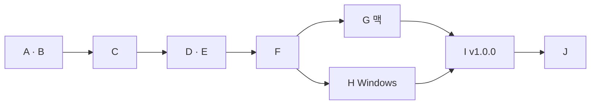

# Skill Drive v1: 진행 현황과 작업 인계

> 기준 시점: 2026-11-23 02:17 (KST), `dev` = `f75a88d`
> 상태: Rust v1 기능 구현 완료. 실제 사용자 환경은 아직 바뀌지 않음
> 설계 문서: `docs/2026-11-23-skill-drive-rust-v1-spec.md` (이하 "스펙")
> 작업 지시서와 보고서: `docs/tasks/2026-11-23-rust-v1/`

이 문서는 병렬로 진행한 작업 전체(Codex stream A~I와 통합 담당 Claude)를 하나로
모은 기록이다. 무엇이 어떻게 진행됐는지, 지금 어디에 있는지, 다음에 무엇을
어떤 순서로 해야 하는지를 적는다. 모든 수치와 상태는 기준 시점에 명령으로 다시
확인한 값이다. 확인 방법은 §9에 있다.

---

## 1. 한눈에 보기

| 항목 | 상태 |
|---|---|
| 목표 | **개인 스킬 드라이브**: 원본 한 곳, 모든 기기와 에이전트는 바로가기(link)로 연결 (스펙 제품 정의) |
| Rust v1 구현 | 19개 명령 모두 연결됨. 구현되지 않은 명령 없음 |
| 테스트 | Rust 188개, Python 308개 모두 통과 |
| CI (`dev`) | Ubuntu, macOS, Windows, Python 모두 통과 (run `45048640883`) |
| 릴리스 | **없음**. 태그와 GitHub Release를 하나도 만들지 않았다. 릴리스 파이프라인은 한 번도 실행되지 않았다 |
| `main` | v0.4.1 그대로. `dev`는 `main`보다 38개 커밋(병합 제외) 앞서 있다 |
| **실제 사용자 환경** | **아직 바뀌지 않았다**: 설치된 CLI는 Python `my-skills 0.4.1`(`~/.local/bin/my-skills`). 연결은 모두 copy로 48건(claude 13, codex 15, agy 15, hermes 5). 레지스트리 `install_mode = "copy"`, git hook 0개 |
| Windows | CI에서 junction 테스트 4개 통과. 실기기에서 세 에이전트가 발견하는지는 **아직 확인하지 않았다** |

---

## 2. 진행 경과


| 시각 | 일 | 커밋 |
|---|---|---|
| 01:04~01:09 | 스펙 작성. Q2(pre-commit은 바뀐 스킬만, staged 기준)와 Q4(sync 해제를 기본으로)를 결정 | `7ae23f6`, `19d299c` |
| 01:13~01:16 | Rust 뼈대, 모듈 계약, 공통 YAML 라이브러리(`yaml-rust2`), 1단계 지시서 | `fed00db`, `03f5cca`, `df032fb` |
| 01:16~01:32 | **1단계 병렬**: Codex 5개(A, B, D, E, F), 각자 worktree. 같은 시간에 통합 담당이 C(link)와 planner·installer 작성 | `4f3a936`, `6057643` 외 |
| 01:32~01:35 | 다섯 브랜치 병합(충돌 없음), 드라이브 통합 테스트 12개 | `b337d23` |
| 01:35~01:41 | 첫 CI 실패(clippy) 수정, 실행 환경(runtime)과 CLI 플래그를 v0.4.1과 맞춤, 2단계 뼈대 | `61f59b6`, `86d3dba` |
| 01:43~02:04 | **2단계 병렬**: Codex 3개(G, H, I). 같은 시간에 통합 담당이 명령 10개를 연결하고 스펙 갱신 | `3167f71`, `1f602a4` 외 |
| 02:04~02:17 | 세 브랜치 병합(`Cargo.toml` 주석 충돌만 있음), 두 기기 흐름 실행 확인, CI 실패 3회 수정 | `01a725c`~`f75a88d` |

Codex 설정과 사용량:
- 1단계는 `gpt-6.2-sol` `xhigh` 5개로 진행했고, 5시간 한도의 약 51%포인트를 썼다(99% → 48%).
- 2단계는 `gpt-6.2-sol` `high` 3개로 진행했고, 약 47%포인트를 썼다(48% → 1%).
- 02:04 기준으로 남은 한도는 **1%** 다.

---

## 3. 작업 단위별 결과

모든 브랜치는 `dev`에 병합됐다(`dev-stream-*`, 병합되지 않은 커밋 0개).
각 단위의 상세 내용은 `docs/tasks/2026-11-23-rust-v1/reports/stream-<x>.md`에 있다.

| 단위 | 담당 | 산출물 | v0.4.1과 의도적으로 다른 점 | 남은 문제 |
|---|---|---|---|---|
| A hash | Codex | `hash.rs`, golden 11건 | symlink를 따라가지 않음. 경로 I/O 오류를 반환함 | 없음 |
| B manifest/state/data | Codex | `manifest.rs`, `state.rs`, `data.rs` | `install_mode` 기본값을 link로, 값은 link/copy만 허용 | 중단된 저장이 `.tmp` 파일을 남기면 다음 저장이 막힘(이전 상태는 보존됨) |
| C link | Claude | `link.rs` (Unix symlink, Windows junction → symlink → copy 대체) | 새로 만든 기능 | 실기기 미확인 |
| D validate | Codex | `frontmatter.rs`, `validate.rs`, 비교 340건 | PyYAML 1.1의 yes/no·8진수·날짜·중복 키를 PyYAML과 같게 처리 | YAML 문법의 드문 경계에서 오류 문구가 다를 수 있음 |
| E audit | Codex | `audit/` (규칙 15개 전부), golden 30건 | Python 전용 정규식 일부를 같은 결과가 나오게 다시 씀 | Unicode 데이터 버전 차이(16.0과 15.1)가 일부 규칙에 영향을 줄 수 있음 |
| F CI/릴리스 | Codex | CI 3개 OS, `release-rust.yml`, `install.sh`, `install.ps1` | 새로 만든 기능 | **릴리스 workflow와 설치 스크립트가 GitHub에서 한 번도 실행되지 않았음** |
| G hooks/doctor | Codex | `hooks.rs`, `commands/{hooks,doctor}.rs` | doctor에 link 가능 여부, git 상태, hook, 연결 집계, 전체 검증을 추가 | `hooks uninstall --dry-run` 없음 (계약 변경 요청) |
| H registry | Codex | init-registry, skills, share, import, enable, disable, seed 포함 | 새 레지스트리는 `install_mode = "link"`로 생성 | share·import·init-registry·enable·disable에 `--dry-run` 없음 (계약 변경 요청). 중단된 편집이 `.edit-lock`을 남길 수 있음 |
| I update | Codex | Release 기반 자체 업데이트, Python 0.4.x guard | Rust의 main 채널은 prerelease를 포함한 최신 Release를 뜻함 | Windows에서 `.old` 파일이 남을 수 있음. **Python guard는 stable 채널만 막음** (§6) |
| 통합 | Claude | `plan.rs`, `install.rs`, `runtime.rs`, `cli.rs`, `commands/{connect,inspect}.rs`, 통합·black-box 테스트 | sync가 등록된 스킬 전체를 대상으로 함(해제를 위해). `--all`은 "비활성 스킬도 연결"이라는 v0.4.1 의미로 유지 | — |

---

## 4. 검증 현황

### 확인한 것

| 무엇 | 방법 | 결과 |
|---|---|---|
| v0.4.1과 같은 동작 | Python이 만든 golden 데이터와 비교 (hash, state, validate, audit, manifest 편집) | 일치 |
| 안전 불변식 I1~I8 | 임시 파일시스템 테스트 | 통과 |
| 드라이브 동작 | `tests/drive_reconcile.rs`, `tests/cli_connect.rs` | 통과 |
| 두 기기 흐름 | 임시 HOME 두 개로 실제 binary 실행 | 새 레지스트리는 link로 생성됨. bootstrap하면 link로 연결됨. 깨진 스킬 커밋은 차단됨. A에서 추가한 스킬은 B에서 pull만 하면 자동 연결되고, A에서 끈 스킬은 B에서 pull만 하면 자동 해제됨 |
| Windows 빌드와 junction | GitHub Actions `windows-latest` | 통과 |

### 확인하지 않은 것

- 세 에이전트(Claude, Codex, agy)가 **실제 Windows에서** junction 스킬을 발견하는지 (스펙 §12)
- 릴리스 workflow, 설치 스크립트, `update`의 실제 다운로드 (Release가 아직 없음)
- Git Bash에서의 hook 실행 (Windows)
- 실제 레지스트리 43건 전환 (아직 하지 않음)

### CI가 잡아 고친 문제

| 커밋 | 문제 |
|---|---|
| `61f59b6` | 중복 `use`, Windows 전용 코드의 불필요한 `return` |
| `86d3dba` | Windows에서 audit 테스트의 경로 구분자 |
| `c6db25f` | CI의 Rust 1.100에서만 걸리는 lint (이 맥은 1.96) |
| `7abe1a1` | **실제 버그**: Windows에서 `~` 경로가 `\`와 `/`가 섞인 형태로 펼쳐짐 |
| `f75a88d` | Linux 병렬 테스트의 `ETXTBSY` 타이밍 문제 |

---

## 5. 결정 기록

| 결정 | 누가 | 어디에 기록됐나 |
|---|---|---|
| 제품 정의는 개인 스킬 드라이브, 기본 연결은 link | 사용자 | 스펙 머리말, D1 |
| 검증은 commit 시점(pre-commit)에서 | 합의 | D2 |
| sync는 해제까지 기본으로 함 | 사용자 (Q4) | D3 |
| pre-commit은 바뀐 스킬만, staged 내용 기준 | 사용자 (Q2) | §6.7 |
| Rust로 재작성, Python 0.4.x는 동결 | 사용자 | D5 |
| 두 기기(macOS·Windows) 모두 세 에이전트 사용, Windows 작업은 Windows PC에서 | 사용자 | §12 |
| 레지스트리(`my-agent-skills`)와 CLI(`my-skills`)를 분리 유지 | 사용자 | §3.1 |
| sync 대상은 등록된 스킬 전체, `--all`은 v0.4.1 의미 유지 | 구현 중 | D3 |
| YAML 라이브러리는 `yaml-rust2` | 구현 중 | `Cargo.toml` 주석 |
| v1.0.0 전에 Python 0.4.2를 먼저 배포 | 구현 중 | Q8 |
| Codex 모델: astra는 사용 보류(사용량 소모가 큼) | 사용자 | 이 문서 |

---

## 6. 알려진 문제와 이전 보고의 오류

### 놓쳤거나 잘못 보고한 것 (통합 담당)

1. **에이전트가 실제로 읽는 문서가 아직 copy·동기화 방식을 설명한다.** 이전 남은 일 목록에서는 "README와 seed"만 적었다. 실제로 고쳐야 할 곳은 아래 표의 전체다. 레지스트리의 `my-skills` 스킬은 tool repo의 seed와 다른 별도 사본이라, seed를 고쳐도 에이전트가 보는 내용은 바뀌지 않는다.

   | 위치 | 내용 |
   |---|---|
   | `~/git/my-agent-skills/skills/my-skills/SKILL.md:18` | host 폴더는 "build outputs", `install`·`sync`가 복사한다고 설명 |
   | `~/git/my-agent-skills/AGENTS.md:3, 9, 11, 35` | "agy는 복사 설치를 유지한다", 동기화 단계 |
   | `~/git/my-agent-skills/instructions/global.md:3, 9` | 동기화 단계가 있는 완료 절차 |
   | `~/.claude/CLAUDE.md:28, 34`, `~/.codex/AGENTS.md:20, 26`, `~/.gemini/GEMINI.md:106, 112` | 같은 절차가 배포된 전역 안내 세 곳 |
   | tool repo `README.md:73-74, 330`, `README.ko.md:16, 22, 74, 78` | copy가 기본이라는 설명 |
   | tool repo `skills/my-skills/SKILL.md:15` | seed. Python 0.4.x 패키지에도 들어가므로 0.4.2 태그 이후에 고친다 |

2. **Python guard는 stable 채널만 막는다** (`src/my_skills/update_commands.py`). `update --channel main`을 쓰는 0.4.x 사용자는 `main`의 최신 커밋을 받는다. 그래서 `main`이 Rust로 바뀌면 update가 깨진다. 0.4.2를 배포하기 전에 main 채널도 막아야 한다.
3. **`dev`를 `main`에 병합하자고 제안했다가 철회했다.** README의 설치 명령(`uv tool install git+https://github.com/Seosiju/my-skills.git`, 태그 없음)이 `main`을 설치하기 때문에, 병합하면 공개 사용자에게 미완성 코드가 전달된다.
4. **"맥 전환에 alpha가 먼저 필요하다"는 말은 사실이 아니었다.** 필수 조건이 아니라 제 선호였다. 이 맥에서 직접 빌드한 binary로도 전환할 수 있다.
5. **단계 번호가 섞였다.** 스펙 §9의 "3단계(전환)"와 제 로드맵의 "④"가 같은 일을 가리켰다. 이 문서부터는 §7의 문자(A~K)로만 부른다.
6. **CLI 계약이 스펙과 어긋난다.** 스펙 §6은 "모든 쓰기 명령은 `--dry-run`을 지원한다"고 했지만, 뼈대 CLI는 v0.4.1 플래그만 따랐다. G와 H가 이 차이를 보고했다.
7. **작업 운영상의 실수.** 모델 목록을 확인하지 않고 `sol`을 썼다. 다섯 개 모두 `xhigh`로 돌렸다. 작업 크기를 고르게 나누지 못했다(A가 너무 작았다). 뼈대 CLI 플래그가 v0.4.1과 달라서 2단계 전에 고쳐야 했다. 이 맥의 Rust가 CI보다 오래된 버전이라 CI에서만 걸리는 lint가 세 번 나왔다.

### 그 밖의 알려진 문제

- 구조: Rust 모듈 21개가 한 층에 나열돼 있어 기능별로 묶이지 않았다. Rust 테스트 일부가 Python 쪽 폴더(`tests/golden/audit/`, `tests/fixtures/`, `src/my_skills/audit/builtin_rules.yaml`)에 기대고 있다. §7 A에서 정리한다.
- 스펙의 열린 질문 Q1(Windows 경로 실측), Q3(Windows state 경로), Q5(코드 서명), Q7(0.4.x 안내)은 아직 결정하지 않았다.
- `~/conductor/workspaces/my-skills-v1/*` worktree 5개는 이 작업과 무관하다. 다른 도구가 남긴 것이고 `prunable` 상태다.

---

## 7. 남은 작업

### 목록

| ID | 할 일 | 반드시 먼저 끝나야 하는 것 | 승인 |
|---|---|---|---|
| A | Rust를 기능별로 재배치(`registry/`, `drive/`, `check/`, `git/`, `update/`, `platform/`)하고 테스트 데이터를 crate 안으로 옮김 | — | 필요 없음 |
| B | 쓰기 명령의 `--dry-run` 보완 (`hooks uninstall`, `share`, `import`, `init-registry`, `enable`, `disable`) | — | 필요 없음 |
| C | Python 0.4.2: `main`에서 `release/v0.4.2`를 만들고 guard를 반영(**main 채널 포함**), 버전과 CHANGELOG → 태그 → `main`에 병합 | — | **필요 (태그, `main` 변경)** |
| D | `dev`에서 Python 제거, Rust를 루트 `src/`, `tests/`로 이동, CI에서 Python 작업 제거 | C | 필요 없음 |
| E | tool repo README와 seed를 link 방식으로 수정 | D | 필요 없음 |
| F | `v1.0.0-alpha.1` pre-release (`dev`에 태그) | — (A·D 뒤가 깔끔하지만 필수는 아님) | **필요 (태그)** |
| G | **맥 전환**: binary 설치 → `convert --to link` dry-run → 승인 → 전환. 레지스트리 `install_mode` 수정, `hooks install`, §6의 문서 전체 수정(전역 안내 세 곳 포함) | binary 하나 (F 또는 직접 빌드) | **필요 (dry-run 확인 후)** |
| H | Windows 실기기: 설치 → clone → `bootstrap` → `hooks install` → 스펙 §12 체크리스트 | binary 하나 (F 또는 그 PC에서 빌드) | 사용자가 Windows PC에서 진행 |
| I | v1.0.0: `dev`를 `main`에 병합하고 README를 binary 설치로 바꾼 뒤 태그 | C, G, H | **필요** |
| J | 자동 pull (macOS launchd, Windows 작업 스케줄러) | I | 스펙 작성 후 승인 |
| K | worktree 정리 (`~/git/my-skills-worktrees/*` 8개, 브랜치 `dev-stream-*`) | — | 확인 후 진행 |

### 권장 순서



- 맥 전환을 서둘러야 하면 G를 A 바로 다음으로 당길 수 있다. 이때는 직접 빌드한 binary를 쓰고, 나중에 F의 binary로 한 번 더 교체한다.
- G는 실제 스킬 폴더 43건과 전역 안내를 바꾼다. dry-run과 바뀔 문서의 diff를 먼저 보여 주고 승인을 받는다.
- 태그(C, F, I)는 공개 저장소에 영구적으로 남는다. 실패하면 태그를 옮기거나 지우지 않고 번호를 올린다(예: `alpha.2`).

---

## 8. 이어서 작업하는 방법

### 시작 전에 확인할 것

```bash
cd ~/git/my-skills && git switch dev && git pull
git status -sb                       # dev...origin/dev, clean
gh run list --branch dev --limit 1   # 마지막 CI 결과
my-skills --version                  # 지금은 Python 0.4.1 (전환 전까지)
```

### 빌드와 검사 (이 맥)

`~/.cargo/bin`에 있는 rustup proxy 때문에 `cargo fmt`와 `cargo clippy`는 이 맥에서 실패한다. 도구를 직접 부른다.

```bash
cargo build && cargo test
rustfmt --edition 2024 $(git ls-files 'crates/*.rs')
/opt/homebrew/bin/cargo-clippy clippy --all-targets -- -D warnings
uv run pytest            # Python 0.4.x (D 전까지)
```

이 맥은 Rust 1.96이고 CI는 1.100이다. 이 맥에서 깨끗해도 CI의 lint가 더 엄격할 수 있다. push 후 반드시 CI를 확인한다. Windows 전용 코드(`cfg(windows)`)는 CI에서만 컴파일된다.

### 규칙

- 실제 사용자 상태를 테스트에 쓰지 않는다: `~/git/my-agent-skills`, host 스킬 폴더, `~/.local/state/my-skills` 등. 테스트는 임시 `HOME`, `XDG_*`, `MY_SKILLS_ROOT`로 격리한다.
- 안전 불변식(스펙 §4)을 깨는 변경은 하지 않는다. 특히 재귀 삭제는 `install.rs`의 `remove_real_dir` 하나만 쓴다.
- 공개 저장소이므로 개인 경로, 계정, 실제 스킬 이름을 커밋하지 않는다.
- 태그, `main` 변경, 실제 사용자 환경 변경은 §7의 승인 지점에서만 한다.

### Codex에 병렬로 맡길 때

- Herdr pane에서 `codex --yolo -m gpt-6.2-sol -c 'model_reasoning_effort="high"'`로 실행한다. astra는 보류 중이다.
- 작업당 worktree 하나(`~/git/my-skills-worktrees/stream-<x>`), 브랜치 `dev-stream-<x>`.
- 지시서는 `docs/tasks/2026-11-23-rust-v1/README.md`의 규칙 1~10과 `phase2-README.md`를 기준으로 쓴다.
- 작업 크기를 비슷하게 나눈다. 정답을 비교할 기준(golden, 테스트)이 있는 작업은 `high`로 충분하다.
- 5시간 사용량을 확인한 뒤 시작한다(02:04 기준 1%).

### Windows PC에서 이어갈 때 (H)

스펙 §12 "Windows 작업 지시서"를 그대로 넘긴다. 결과는 스펙 §12 "Windows 확인 결과"의 "실기기" 항목에 적고 `dev`에 커밋한다. F 전이라면 그 PC에서 `cargo build --release`로 만든 binary를 쓴다.

---

## 9. 이 문서의 수치를 다시 확인하는 방법

```bash
git log --oneline --no-merges main..dev | wc -l          # 38
cargo test -q 2>&1 | grep "test result" | awk '{p+=$4;f+=$6} END{print p,f}'   # 188 0
uv run pytest -q | tail -1                                # 308 passed
gh run list --branch dev --limit 1                        # success
git ls-remote --tags origin                               # v0.4.1이 최신, v1 태그 없음
python3 -c "import json,collections;d=json.load(open('$HOME/.local/state/my-skills/state.json'));print(collections.Counter((r['host'],r['mode']) for r in d['installs']))"
grep -n install_mode ~/git/my-agent-skills/my-skills.toml   # "copy"
```
