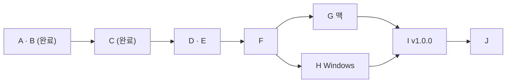

# Skill Drive v1: 진행 현황과 작업 인계

> 기준 시점: 2026-11-23 (KST). `dev` = `1104b30` 이후 (감사 반영 `b79dbf5`, §7 B `ee2ad94`, §7 A `b1113e8`·`2368f93`)
> 상태: Rust v1 기능 구현, 감사 지적 수정, §7 A·B 완료. 실제 사용자 환경은 아직 바뀌지 않음
> 설계 문서: `docs/2026-11-23-skill-drive-rust-v1-spec.md` (이하 "스펙")
> 작업 지시서와 보고서: `docs/tasks/2026-11-23-rust-v1/`

이 문서는 병렬로 진행한 작업을 하나로 모은 기록이다. 포함한 작업은 Codex stream A~I, 통합 담당 Claude, 독립 감사 세션(agy)이다.
무엇이 어떻게 진행됐는지, 지금 어디에 있는지, 다음에 무엇을 어떤 순서로 해야 하는지를 적는다.
수치와 상태는 기준 시점에 명령으로 다시 확인한 값이고, 확인 방법은 §9에 있다.

공개 저장소이므로 사용자 기기의 경로 구조, 실제 연결 수, 전역 안내 파일의 줄 번호는 적지 않는다.
기기별 값은 전환할 때 `doctor`와 dry-run 출력으로 직접 확인한다.

---

## 1. 한눈에 보기

| 항목 | 상태 |
|---|---|
| 목표 | **개인 스킬 드라이브**: 원본은 한 곳에 두고, 모든 기기와 에이전트는 바로가기(link)로 연결한다 (스펙 제품 정의) |
| Rust v1 구현 | 19개 명령 모두 연결됨 |
| 테스트 | Rust 209개, Python 308개 모두 통과 |
| CI (`dev`) | Ubuntu, macOS, Windows, Python. 최신 결과는 §9 명령으로 확인 |
| 릴리스 | **Python v0.4.2** (태그 `v0.4.2`, GitHub Release "Latest"). Rust v1 릴리스는 아직 없고, Rust 릴리스 workflow도 실행되지 않았다 |
| `main` | v0.4.2 (`ca41abd`, `release/v0.4.2` 병합). Rust 코드는 아직 없다. `main`은 `dev`에 다시 병합했다(`382a19a`) |
| **실제 사용자 환경** | **바뀌지 않았다**. 설치된 CLI는 Python `my-skills 0.4.1`, 모든 연결은 copy, 레지스트리 `install_mode = "copy"`, git hook 없음 |
| 감사 세션의 사전 점검 | 빌드한 v1 binary를 실제 레지스트리에 읽기 전용으로 실행: 모든 연결이 FRESH였고, `convert --to link --host all --dry-run`은 막힌 항목 없이 활성 host의 copy 연결 전체를 CONVERT로 계획했다. 비활성 host(hermes) 기록은 대상에서 빠졌다 |
| Windows | CI에서 junction 테스트 4개 통과. 실기기에서 세 에이전트가 junction 스킬을 발견하는지는 **아직 확인하지 않았다** |

---

## 2. 진행 경과


| 시각 | 일 | 커밋 |
|---|---|---|
| 01:04~01:09 | 스펙 작성. Q2(pre-commit은 바뀐 스킬만, staged 기준)와 Q4(sync 해제를 기본으로)를 결정 | `7ae23f6`, `19d299c` |
| 01:13~01:16 | Rust 뼈대, 모듈 계약, 공통 YAML 라이브러리(`yaml-rust2`), 1단계 지시서 | `fed00db`, `03f5cca`, `df032fb` |
| 01:16~01:32 | **1단계 병렬**: Codex 5개(A, B, D, E, F), 작업마다 worktree 하나. 같은 시간에 통합 담당이 C(link)와 planner·installer 작성 | `4f3a936`, `6057643` 외 |
| 01:32~01:35 | 다섯 브랜치 병합(충돌 없음), 드라이브 통합 테스트 12개 추가 | `b337d23` |
| 01:35~01:41 | 첫 CI 실패(clippy) 수정, 실행 환경과 CLI 플래그를 v0.4.1과 맞춤, 2단계 뼈대 | `61f59b6`, `86d3dba` |
| 01:43~02:04 | **2단계 병렬**: Codex 3개(G, H, I). 같은 시간에 통합 담당이 명령 10개 연결 | `3167f71`, `1f602a4` 외 |
| 02:04~02:17 | 세 브랜치 병합, 두 기기 흐름 실행 확인, CI 실패 3회 수정 | `01a725c`~`f75a88d` |
| 02:3x | 첫 인계 문서 | `124b817` |
| 03:15 | **독립 감사**(agy 세션): 인계 문서에도 없던 코드 결함 6건, 빠진 문서, 공개 문서의 개인 운영 정보, 위생 테스트 공백 보고 | 보고서는 그 세션에 있음 |
| 03:15~03:25 | 감사 항목을 하나씩 재확인(모두 사실). 높음 3건과 작은 결함 수정, 위생 테스트 Rust 이식, 이 문서 개정, 공개 문서 일반화 | `b79dbf5`, `f98fca5` |
| 이후 | §7 B: 남은 쓰기 명령에 `--dry-run` 추가. §7 A: 모듈을 기능별로 재배치하고 테스트 데이터를 crate 안으로 이동 | `ee2ad94`, `b1113e8`, `2368f93` |
| 이후 | Windows 실행 문서 작성 | `4dcce46` |
| 08:15 | **두 번째 검토**(agy 세션): Windows 실행 문서와 최근 커밋 검토. 문서 보완 제안 5건, 코드·CI 참고 2건 | 보고서는 그 세션에 있음 |
| 이후 | 제안을 하나씩 재확인(모두 사실). **문서만 수정**하고 코드·CI 항목은 §7 L로 기록 | `b99b514`, `aff3bee` |
| 이후 | **§7 C 완료**: `release/v0.4.2`에서 main 채널 guard, 태그 기준 이전 링크, doctor 안내를 추가하고 v0.4.2로 배포. `main`을 `dev`에 병합 | `f97a065`, `ca41abd`, 태그 `v0.4.2`, `382a19a` |
| 이후 | **Windows PC 점검**(H의 준비 절과 1~2단계 일부): Rust 환경 준비됨. 테스트가 실제 사용자 위치에 쓰는 문제 발견(Python은 host 폴더와 `%LOCALAPPDATA%`, Rust는 1건이 `%LOCALAPPDATA%`)(§6.5). 같은 날 Codex 독립 검토를 반영해 보고서 개정 | `docs/2026-11-23-skill-drive-windows-python-tests-report.md` |

Codex 운영:
- 1단계: `gpt-6.2-sol` `xhigh` 5개. 5시간 한도의 약 51%포인트를 썼다(99% → 48%).
- 2단계: `gpt-6.2-sol` `high` 3개. 약 47%포인트를 썼다(48% → 1%).
- 감사 이후에는 Codex를 쓰지 않았다.

---

## 3. 작업 단위별 결과

모든 `dev-stream-*` 브랜치는 `dev`에 병합됐다(병합되지 않은 커밋 0개).
각 단위의 상세 내용은 `docs/tasks/2026-11-23-rust-v1/reports/stream-<x>.md`에 있다.
아래 표와 보고서의 파일 이름은 §7 A의 재배치 이전 이름이다. 지금 위치는 §6.3의 대응표를 따른다.

| 단위 | 담당 | 산출물 | v0.4.1과 의도적으로 다른 점 | 남은 문제 |
|---|---|---|---|---|
| A hash | Codex | `hash.rs`, golden 11건 | symlink를 따라가지 않음. 경로 I/O 오류를 반환함 | 없음 |
| B manifest/state/data | Codex | `manifest.rs`, `state.rs`, `data.rs` | `install_mode` 기본값을 link로, 값은 link/copy만 허용 | 남은 `.tmp` 파일이 다음 저장을 막음(이전 상태는 보존됨) |
| C link | Claude | `link.rs` (Unix symlink, Windows junction → symlink → copy 대체) | 새로 만든 기능 | 실기기 미확인 |
| D validate | Codex | `frontmatter.rs`, `validate.rs`, 비교 340건 | PyYAML 1.1의 yes/no·8진수·날짜·중복 키를 PyYAML과 같게 처리 | YAML 문법의 드문 경계에서 오류 문구가 다를 수 있음 |
| E audit | Codex | `audit/` (규칙 15개 전부), golden 30건 | Python 전용 정규식 일부를 같은 결과가 나오게 다시 씀 | Unicode 데이터 버전 차이(16.0과 15.1) |
| F CI/릴리스 | Codex | CI 3개 OS, `release-rust.yml`, `install.sh`, `install.ps1` | 새로 만든 기능 | **한 번도 실행되지 않음**. 태그와 `Cargo.toml` 버전을 비교하는 검사가 없음(§7 F) |
| G hooks/doctor | Codex | `hooks.rs`, `commands/{hooks,doctor}.rs` | doctor에 link 가능 여부, git 상태, hook, 연결 집계, 전체 검증 추가 | `hooks uninstall --dry-run` 없음(§7 B) |
| H registry | Codex | init-registry, skills, share, import, enable, disable, seed 포함 | 새 레지스트리는 `install_mode = "link"`로 생성 | `--dry-run` 없음(§7 B). 남은 `.edit-lock`. 새 레지스트리 README 템플릿이 `uv tool install`을 안내함(§7 E) |
| I update | Codex | Release 기반 자체 업데이트, Python 0.4.x guard | Rust의 main 채널은 prerelease를 포함한 최신 Release를 뜻함 | Windows에서 `.old` 파일이 남을 수 있음. **Python guard는 stable 채널만 막고, 0.4.x `doctor`는 이전 안내를 출력하지 않음**(§7 C) |
| 통합 | Claude | `plan.rs`, `install.rs`, `runtime.rs`, `cli.rs`, `commands/{connect,inspect}.rs`, 통합·black-box 테스트 | sync는 등록된 스킬 전체를 대상으로 함(해제를 위해). `--all`은 v0.4.1 의미 유지 | §6 참고 |
| 감사 | agy | 독립 재검증과 결함 보고 | — | 지적 사항은 §6에서 반영 여부와 함께 정리 |

---

## 4. 검증 현황

### 확인한 것

| 무엇 | 방법 | 결과 |
|---|---|---|
| v0.4.1과 같은 동작 | Python이 만든 golden 데이터와 비교 (hash, state, validate, audit, manifest 편집) | 일치 |
| 안전 불변식 I1~I8 | 임시 파일시스템 테스트 | 통과 |
| 드라이브 동작 | `drive_reconcile.rs`, `cli_connect.rs` | 통과 |
| 두 기기 흐름 | 임시 HOME 두 개로 실제 binary 실행 | 새 레지스트리는 link로 생성됨. bootstrap하면 link로 연결됨. 깨진 스킬 커밋은 차단됨. A에서 추가한 스킬은 B에서 pull만 하면 자동 연결되고, A에서 끈 스킬은 B에서 pull만 하면 자동 해제됨 |
| 실제 레지스트리 호환 | 감사 세션이 읽기 전용으로 실행(`MY_SKILLS_ROOT`, 임시 `XDG_CONFIG_HOME`) | 전부 FRESH, validate·audit 전부 OK, convert dry-run 막힌 항목 0 |
| Windows 빌드와 junction | GitHub Actions `windows-latest` | 통과 |
| 감사 지적 수정 | 수정마다 회귀 테스트 추가(`cli_connect.rs`에 5개, `gate_policy.rs`, `public_hygiene.rs`) | 통과 |

### 확인하지 않은 것

- 세 에이전트가 **실제 Windows에서** junction 스킬을 발견하는지 (스펙 §12)
- 릴리스 workflow, 설치 스크립트, `update`의 실제 다운로드
- Git Bash에서의 hook 실행 (Windows)
- 실제 레지스트리의 전환(쓰기)

### CI가 잡아 고친 문제

| 커밋 | 문제 |
|---|---|
| `61f59b6` | 중복 `use`, Windows 전용 코드의 불필요한 `return` |
| `86d3dba` | Windows에서 audit 테스트의 경로 구분자 |
| `c6db25f` | CI의 Rust 1.100에서만 걸리는 lint (이 맥은 1.96) |
| `7abe1a1` | **실제 버그**: Windows에서 `~` 경로가 `\`와 `/`가 섞인 형태로 펼쳐짐 |
| `f75a88d` | Linux 병렬 테스트의 `ETXTBSY` 타이밍 문제 |

---

## 5. 결정 기록

| 결정 | 누가 | 어디에 기록됐나 |
|---|---|---|
| 제품 정의는 개인 스킬 드라이브, 기본 연결은 link | 사용자 | 스펙 머리말, D1 |
| 검증은 commit 시점(pre-commit)에서 | 합의 | D2 |
| sync는 해제까지 기본으로 함 | 사용자 (Q4) | D3 |
| pre-commit은 바뀐 스킬만, staged 내용 기준 | 사용자 (Q2) | §6.7 |
| Rust로 재작성, Python 0.4.x는 동결 | 사용자 | D5 |
| 두 기기(macOS·Windows) 모두 세 에이전트 사용, Windows 작업은 Windows PC에서 | 사용자 | §12 |
| 레지스트리와 CLI(`my-skills`)를 분리 유지 | 사용자 | §3.1 |
| sync 대상은 등록된 스킬 전체, `--all`은 v0.4.1 의미 유지 | 구현 중 | D3 |
| YAML 라이브러리는 `yaml-rust2` | 구현 중 | `Cargo.toml` 주석 |
| v1.0.0 전에 Python 0.4.2를 먼저 배포 | 구현 중 | Q8 |
| `main`은 v1.0.0 때까지 병합하지 않음. 0.4.2는 `release/v0.4.2`에서 배포 | 구현 중 (사용자 확인) | §7 C, I |
| Codex는 `sol` `high`를 기본으로, astra는 보류(사용량 소모가 큼) | 사용자 | §8 |
| 공개 문서의 개인 운영 정보는 새 커밋으로 일반화하고 이력은 그대로 둠 | 사용자 | 이 문서 머리말 |
| pre-commit과 doctor는 같은 검사(`validate::gate_errors`)를 씀: host 검사와 manifest `[audit]` 정책 포함 | 감사 반영 | §6 |

---

## 6. 알려진 문제, 이전 보고의 오류, 감사 반영

### 6.1 감사에서 나온 코드 결함과 처리

| 심각도 | 결함 | 처리 |
|---|---|---|
| 높음 | `sync --check`가 비활성 스킬과 등록 해제된 스킬을 건너뛰어, 해제해야 할 link가 있어도 종료 코드 0을 돌려줌 | **수정** (`b79dbf5`). 전체 reconcile 계획 기준으로 판정하고 `PRUNE` 줄을 출력 |
| 높음 | `convert`가 state 저장 전에 backup을 삭제. 원본이 없는 copy도 CONVERT로 계획. 기록된 경로와 manifest 경로의 기준이 다름 | **수정**. link → state 저장 → backup 삭제 순서이고, 저장에 실패하면 되돌림. 원본이 없거나 경로가 다르면 BLOCK_DRIFT. backup은 원본과 같은 내용이라 사용자 데이터 유실은 아니었음 |
| 높음 | pre-commit이 manifest `[audit]` 정책을 무시. doctor 전체 검사는 host 검사를 안 함 | **수정**. `validate::gate_errors`로 통일 |
| 중간 | 릴리스 태그와 `Cargo.toml` 버전을 비교하지 않음. 지금 `1.0.0-alpha.0`이라, 그대로 `alpha.1` 태그를 붙이면 `update`가 항상 실패함 | **§7 F에 추가** (버전 올리기, CI 검사, `workflow_dispatch` 시험 실행) |
| 중간 | 새 레지스트리 README 템플릿이 `uv tool install`을 안내. `SEED_REVISION = "0.4.1"` | **§7 E에 추가** |
| 중간 | `seeds.rs`의 직접 재귀 삭제 | **수정**. `install::remove_real_dir`로 일원화 |
| 중간 | Python 0.4.2 `doctor`가 v1 이전 안내를 출력하지 않음 | **§7 C에 추가** |
| 낮음 | bootstrap dry-run 미리보기에 `--mode`가 빠짐 | **수정** |
| 낮음 | install 검증이 스킬의 `hosts`에 없는 host도 검사함 (v0.4.1에서 물려받음) | **수정** (`ee2ad94`) |
| 낮음 | 기록의 `source_type`이 항상 `"canonical"`. copy 갱신(`Update`)도 state 저장 전에 backup을 지움(내용은 옛 원본이라 유실 없음) | **그대로 둠**. v0.4.1과 같은 동작이고 데이터 유실이 없다 |

### 6.2 이전 보고의 오류 (통합 담당)

1. **에이전트가 실제로 읽는 문서를 수정 목록에서 빠뜨렸다.** 처음에는 "README와 seed"만 적었다. 고쳐야 할 전체 목록은 §7 E와 G에 있다. 레지스트리 안의 `my-skills` 스킬은 tool repo의 seed와 별개의 사본이라, seed를 고쳐도 에이전트가 보는 내용은 바뀌지 않는다.
2. **"공개 저장소에 개인 정보는 들어가지 않았다"고 말했다.** 사용자 이름과 이메일만 검색한 결과였다. 실제로는 개인 경로 구조, 실제 연결 수, 전역 안내 파일 줄 번호가 공개 문서에 들어가 있었다. 사용자 결정에 따라 새 커밋으로 일반화했다(스펙, 작업 지시서, 이 문서). `2026-07-04` 문서는 이 작업 전부터 있던 것이라 그대로 두었다.
3. **Python guard가 stable 채널만 막는다는 것을 늦게 발견했다.**
4. **`dev`를 `main`에 병합하자고 제안했다가 철회했다.** README의 설치 명령이 태그 없이 `main`을 설치하기 때문이다.
5. **"맥 전환에는 alpha가 먼저 필요하다"고 했지만 필수 조건이 아니었다.** 직접 빌드한 binary로도 전환할 수 있다.
6. **단계 번호를 섞어 썼다.** 이 문서부터는 §7의 문자(A~K)로만 부른다.
7. **CLI 계약이 스펙 §6의 "모든 쓰기 명령은 `--dry-run`"과 어긋났다.**
8. **작업 운영상의 실수.** 모델 목록을 확인하지 않았다. 다섯 개 모두 `xhigh`로 돌렸다. 작업 크기를 고르게 나누지 못했다. 뼈대 CLI 플래그가 v0.4.1과 달랐다. 이 맥의 Rust가 CI보다 오래된 버전이었다.
9. **인계 문서에 "재귀 삭제는 한 곳뿐"이라고 적었지만 사실이 아니었다.** 지금은 수정해서 사실이 됐다(`drive::apply::remove_real_dir`).

### 6.3 그 밖의 알려진 문제와 구조

- **구조 (§7 A에서 정리)**: 모듈 위치가 바뀌었다(`crates/my-skills/src/` 기준).

  | 이전 | 지금 |
  |---|---|
  | `runtime.rs`, `manifest.rs`, `manifest_edit.rs`, `catalog.rs`, `seeds.rs`, `sharing.rs` | `registry/root.rs`, `registry/manifest.rs`, `registry/edit.rs`, `registry/catalog.rs`, `registry/seeds.rs`, `registry/share.rs` |
  | `hosts.rs`, `link.rs`, `plan.rs`, `install.rs`, `state.rs`, `hash.rs`, `ignore.rs` | `drive/hosts.rs`, `drive/link.rs`, `drive/plan.rs`, `drive/apply.rs`, `drive/state.rs`, `drive/hash.rs`, `drive/ignore.rs` |
  | `frontmatter.rs`, `validate.rs`, `audit/` | `check/frontmatter.rs`, `check/validate.rs`, `check/audit/` |
  | `hooks.rs` | `git/hooks.rs` |
  | `self_update.rs` | `update.rs` |
  | `paths.rs`, `data.rs` | `platform/paths.rs`, `platform/data.rs` |

- **Rust가 Python 쪽에 기대는 곳**: 테스트 데이터는 모두 crate 안으로 옮겼다(`tests/fixtures/shared`, `tests/golden/audit`). 남은 곳은 다음과 같다.
  - `tests/audit_parity.rs`: Rust와 Python의 `builtin_rules.yaml`이 같은지 비교한다. 이전 기간에만 필요한 의도된 비교라 §7 D에서 Python과 함께 지운다.
  - `tests/golden/*/generate.py`: Python v0.4.1로 golden 데이터를 다시 만드는 도구다. §7 D 이후에는 기록으로만 남는다.
  - 저장소 루트 기준 경로를 쓰는 곳: `src/registry/seeds.rs`(seed 원본 `skills/`), `tests/public_hygiene.rs`, `tests/registry_init.rs`, `tests/validate_golden.rs`, `tests/audit_parity.rs`. crate를 루트로 옮길 때(§7 D) 경로를 조정한다.
- **import의 dry-run**: 검증과 audit를 위해 레지스트리 안에 임시 staging 폴더와 편집 잠금을 잠깐 만들었다가 지운다. 영구적인 쓰기는 하지 않는다.
- 스펙의 열린 질문 Q1(Windows 경로 실측), Q3(Windows state 경로), Q5(코드 서명), Q7(0.4.x 안내)은 아직 결정하지 않았다.
- 이 작업과 무관한 다른 도구의 worktree가 `git worktree list`에 `prunable`로 남아 있다.

### 6.4 두 번째 검토(Windows 실행 문서)에서 나온 것

사용자 결정에 따라 이번에는 **문서만 고쳤다.** 코드와 CI 항목은 §7 L에 남겼다.

| 지적 | 확인 결과 | 처리 |
|---|---|---|
| runbook 4.3의 미리보기 명령(`status`, `sync --dry-run` 등)이, 활성 레지스트리 기록이 없는 PC에서는 처음 실행할 때 그 기록을 씀 | 사실 (`registry/root.rs`, `resolve_root(None, true)`) | runbook: 미리보기 동안 `MY_SKILLS_ROOT`를 지정. 코드 변경 여부는 §7 L |
| 4.4에서 기존 copy가 일부만 있으면 convert만으로는 남은 연결이 MISSING으로 남음 | 사실 | runbook: convert를 먼저, 그 다음 bootstrap을 항상 실행 |
| 3.5에 post-merge 확인이 없음. 시험용 manifest가 실제 host 폴더를 가리켜, post-* hook을 시험하면 실제 폴더에 대상 없는 junction이 남을 수 있음. Python 판이 PATH에 있으면 3단계에서 hook 검증을 끝낼 수 없음. doctor 출력 필터가 State/Data를 자름 | 사실 | runbook 3.5를 새로 씀: host 경로를 임시 폴더로 돌림, post-checkout·post-merge 확인 추가, Git Bash 세션에서만 Rust 판을 PATH 앞에 둠, Registry~Manifest 전체 확인 |
| 스펙 §12 항목 4(공백 경로), 항목 5(줄바꿈), Q3(기존 state 유무)가 결과 기록에서 빠짐 | 사실. 레지스트리에 `.gitattributes`가 없고 Python 스크립트가 있음 | runbook: 시험 폴더 이름에 공백을 넣음, 4.2에 줄바꿈 확인 추가, 결과 표에 행 추가 |
| PowerShell 5.1 세부: 없는 명령 호출 오류, 에이전트 설치 여부, `Write-Utf8`의 상대 경로, 새 터미널에서 변수 소실, agy 비대화형 조회 | 사실 (agy 조회는 macOS에서 검증된 방법) | runbook에 모두 반영 |
| Linux CI의 `ETXTBSY` 간헐 실패가 `update_cli.rs`에서 재발 (run `45056025212`, 커밋 `0a9ab6f`) | 사실. 재시도는 `registry_init.rs`에만 있고 `support_i.rs`, `hooks_git.rs`에는 없음 | §7 L |
| convert가 state를 두 번 저장 (`drive/apply.rs`의 `commit_record`와 `commands/connect.rs`의 `apply_plan`) | 사실. 결과는 같고 저장 횟수만 두 배 | §7 L |

### 6.5 Windows PC 점검에서 나온 것

상세: `docs/2026-11-23-skill-drive-windows-python-tests-report.md`. 이 보고서는 Codex 독립 검토를 반영해 근거를 [확정], [관찰], [추론], [미확인]으로 나눠 적었다. 이번에도 코드는 고치지 않았다.

| 발견 | 확인 결과 | 처리 |
|---|---|---|
| Rust 개발 환경 (MSVC, Rust 1.100.0, fmt, clippy) | [관찰] fmt, clippy, `cargo test --all-targets` 206개, Windows junction 테스트 4개 모두 통과. 209개와의 차이는 [추론] `cfg(unix)`/`cfg(windows)` 테스트 차이(206 − 4 + 3 + 4) | 기록. release 빌드와 에이전트의 junction 발견 확인은 남음 |
| **Python 테스트가 실제 host 폴더에 씀** | [확정] Windows의 Python은 `HOME`을 무시하고 `USERPROFILE`을 씀. [관찰] 시험용 스킬 8개가 생김. 확인한 범위(이름 목록, `root`/`state.json` 수정 시각, 레지스트리 git 상태와 hook)에서는 다른 변화 없음 | 사용자 승인 후 지움. runbook 경고. §7 L (5) |
| **테스트가 실제 `%LOCALAPPDATA%`에 씀** | [확정: 소스] Python `data.py:34`와 Rust `paths.rs:41`은 Windows에서 `XDG_DATA_HOME`보다 `LOCALAPPDATA`를 먼저 읽음. [관찰] `%LOCALAPPDATA%\my-skills\data\alpha`(빈 폴더)가 생김. [추론] Rust `cli_connect.rs`의 `data-path --create` 테스트가 만듦 | 폴더는 아직 지우지 않음. §7 L (5) |
| Python 테스트 102개 실패, 1개 끝나지 않음 | [확정] 겹치지 않는 로그 분류: TOML 이스케이프 61, symlink 권한 12, POSIX 경로 가정 9, 그 밖 20 (CPython 3.15.2. CI는 Ubuntu, 3.11) | 기록만. §7 D에서 Python을 지울 예정 |
| audit 보고서 경로가 Windows에서 `\` | [확정] Python 실측. [추론] Rust `analyzers.rs:33`도 가능. 해시 입력은 두 판 모두 소스상 이미 `/` | §7 L (6) |

---

## 7. 남은 작업

### 목록

| ID | 할 일 | 반드시 먼저 끝나야 하는 것 | 승인 |
|---|---|---|---|
| A | ~~Rust를 기능별로 재배치하고 Python 폴더 의존을 끊음~~ **완료** (`b1113e8`, `2368f93`) | — | — |
| B | ~~쓰기 명령에 `--dry-run` 추가, §6.1 보류 항목 결정~~ **완료** (`ee2ad94`). `set-root`도 포함했다. `share --dry-run`은 `--plan`과 같다 | — | — |
| C | ~~Python 0.4.2~~ **완료** (태그 `v0.4.2`). stable과 main 채널 모두 v1 태그가 생기면 설치하지 않고 이전 안내를 출력한다. 안내 링크는 이전 대상 태그를 가리키므로 `main`에 Rust가 들어가기 전에도 동작한다. 배포 전 검증: 릴리스 브랜치 CI, `main` CI, 격리된 폴더에서 GitHub 설치 경로 확인 | — | — |
| D | `dev`에서 Python 제거, Rust를 루트 `src/`, `tests/`로 이동, CI에서 Python 작업 제거, §6.3의 루트 기준 경로 조정, `builtin_rules.yaml` 비교 테스트 삭제 | C | 필요 없음 |
| E | tool repo 문서: `README.md`, `README.ko.md`, `AGENTS.md`("host directory = install output", `uv` 명령), seed `skills/my-skills/SKILL.md`, `seeds.rs`의 README 템플릿과 `SEED_REVISION`, `docs/release-checklist.md`의 Python 절차 | D | 필요 없음 |
| F | `v1.0.0-alpha.1` pre-release: `Cargo.toml` 버전을 `1.0.0-alpha.1`로 올림 → 태그와 버전을 비교하는 CI 단계 추가 → `workflow_dispatch`로 시험 실행(binary, `--version`, 설치 스크립트) → 태그 | — (A·D 뒤가 깔끔하지만 필수는 아님) | **필요 (태그)** |
| G | **맥 전환**: binary 설치 → `convert --to link` dry-run → 승인 → 전환. 레지스트리 `install_mode` 수정, `hooks install`. 에이전트가 읽는 문서 수정: 레지스트리의 `skills/my-skills/SKILL.md`, `AGENTS.md`(동기화 단계, agy 복사 설치 문구, 그룹 비활성화 시 uninstall 안내), `instructions/global.md`, `README.md`, 그리고 Claude·Codex·agy 전역 안내의 "동기화" 절차 | binary 하나 (F 또는 직접 빌드) | **필요 (dry-run과 문서 diff 확인 후)** |
| H | Windows 실기기: 설치 → clone → `bootstrap` → `hooks install` → 스펙 §12 체크리스트 | binary 하나 (F 또는 그 PC에서 빌드) | 사용자가 Windows PC에서 진행 |
| I | v1.0.0: `dev`를 `main`에 병합, README를 binary 설치 방식으로, 태그 | C, G, H | **필요** |
| J | 자동 pull (macOS launchd, Windows 작업 스케줄러) | I | 스펙 작성 후 승인 |
| K | worktree 정리 (`dev-stream-*` 8개와 그 브랜치. 디스크 약 12GB) | — | 확인 후 진행 |
| L | 작은 코드 정리: (1) `support_i.rs`와 `hooks_git.rs`에 `ETXTBSY` 재시도 추가, (2) convert의 state 이중 저장 정리, (3) 읽기 전용 명령과 `--dry-run`이 활성 레지스트리 기록을 쓰지 않게 할지 결정, (4) H 결과에 따라 Windows에서 `HOME`보다 `USERPROFILE`을 우선할지 결정. 바꾸면 `HOME`만 바꾸는 Rust 테스트(`cli_connect.rs`, `dry_run.rs`)가 실제 홈에 쓰게 되므로 테스트 격리도 함께 바꾼다, (5) Windows 테스트 격리: 모든 CLI 테스트 환경을 support_g/h/i 수준(`HOME`, `USERPROFILE`, `LOCALAPPDATA`, `XDG_*`)으로 통일하고, `data-path` 테스트에 Windows 위치 검사를 넣고, Windows CI에서 테스트 전후로 사용자 위치(host 폴더, `%LOCALAPPDATA%\my-skills`)를 비교한다. 0.4.x 패치를 낸다면 conftest에 `USERPROFILE`과 `LOCALAPPDATA`를 추가한다(그것만으로 충분한지는 미확인), (6) Windows에서 audit 보고서의 파일 경로 표기를 `/`로 통일할지 결정한다. Python은 `\`로 나오고, Rust는 코드상 그럴 가능성이 있다. 해시 입력은 두 판 모두 이미 `/` | (4)는 H | 필요 없음 (동작 변경인 (3), (4)는 결정 후) |

### 권장 순서



- A·B·C가 끝났으므로 다음은 D·E다. 맥 전환을 서둘러야 하면 G를 먼저 할 수 있다. 이때는 직접 빌드한 binary를 쓰고, 나중에 F의 binary로 한 번 더 교체한다.
- G는 실제 스킬 폴더와 전역 안내를 바꾼다. dry-run과 바뀔 문서의 diff를 먼저 보여 주고 승인을 받는다.
- 태그(C, F, I)는 공개 저장소에 영구적으로 남는다. 실패하면 태그를 옮기거나 지우지 않고 번호를 올린다(예: `alpha.2`).

---

## 8. 이어서 작업하는 방법

### 시작 전에 확인할 것

```bash
cd <tool repo> && git switch dev && git pull
git status -sb                       # dev...origin/dev, clean
gh run list --branch dev --limit 1   # 마지막 CI 결과
my-skills --version                  # 전환 전까지는 Python 0.4.1
```

### 빌드와 검사 (macOS, Homebrew Rust)

`~/.cargo/bin`의 rustup proxy 때문에 `cargo fmt`와 `cargo clippy`가 실패한다. 도구를 직접 부른다.

```bash
cargo build && cargo test
rustfmt --edition 2024 $(git ls-files 'crates/*.rs')
/opt/homebrew/bin/cargo-clippy clippy --all-targets -- -D warnings
uv run pytest            # Python 0.4.x (D 전까지)
```

이 맥의 Rust는 1.96이고 CI는 1.100이라 CI의 lint가 더 엄격하다. push한 뒤 반드시 CI를 확인한다.
Windows 전용 코드(`cfg(windows)`)는 CI에서만 컴파일된다.

### 규칙

- 테스트에 실제 사용자 상태를 쓰지 않는다. 레지스트리, host 스킬 폴더, `~/.local/state/my-skills` 등이 해당한다. 임시 `HOME`, `XDG_*`, `MY_SKILLS_ROOT`로 격리한다.
- 안전 불변식(스펙 §4)을 깨지 않는다. 재귀 삭제는 `drive::apply::remove_real_dir` 하나만 쓴다.
- 공개 저장소에는 개인 경로, 계정, 실제 스킬 이름, 기기별 수치를 커밋하지 않는다. `public_hygiene.rs`가 일부를 검사한다.
- 태그, `main` 변경, 실제 사용자 환경 변경은 §7의 승인 지점에서만 한다.

### Codex에 병렬로 맡길 때

- Herdr pane에서 `codex --yolo -m gpt-6.2-sol -c 'model_reasoning_effort="high"'`로 실행한다. astra는 보류.
- 작업마다 worktree 하나(`<worktrees>/stream-<x>`)와 브랜치 `dev-stream-<x>`를 쓴다.
- 지시서는 `docs/tasks/2026-11-23-rust-v1/README.md`의 규칙 1~10과 `phase2-README.md`를 따른다.
- 작업 크기를 비슷하게 나눈다. 비교할 정답(golden, 테스트)이 있는 작업은 `high`로 충분하다.
- 시작 전에 5시간 사용량을 확인한다.

### Windows PC에서 이어갈 때 (H)

**`docs/2026-11-23-skill-drive-windows-runbook.md`를 그대로 넘긴다.** (두 번째 검토 반영본)
사전 점검, 빌드, 실제 데이터를 건드리지 않는 확인, 실제 연결(dry-run 후 승인), 결과 기록 양식을 순서대로 담았다.
스펙 §12는 확인할 항목의 목록이고, 실행 절차는 이 runbook을 따른다.
- 레지스트리 manifest에는 아직 `install_mode = "copy"`가 명시돼 있다. 그래서 Windows에서는 `my-skills.local.toml`로 link를 지정한다(runbook 4.2).
- hook은 PATH의 `my-skills`를 먼저 찾는다. Python 0.4.x가 앞에 있으면 hook이 잘못 동작한다(runbook 3.5, 4.1). 맥 전환(G)에도 같은 주의가 필요하다.
- **Windows에서 `uv run pytest`를 격리 없이 실행하지 않는다.** 실제 host 폴더와 `%LOCALAPPDATA%`에 쓴다(§6.5, 점검 보고서 §7). Rust `cargo test`도 1건이 `%LOCALAPPDATA%\my-skills\data`에 쓴다(점검 보고서 §5).
- 2026-11-23 점검 기준 진행 상황: 준비 절, 1단계, 2단계의 테스트까지 끝났다. `cargo build --release`와 3단계 이후는 아직 하지 않았다.

---

## 9. 이 문서의 수치를 다시 확인하는 방법

```bash
git log --oneline --no-merges main..dev | wc -l
cargo test -q 2>&1 | grep "test result" | awk '{p+=$4;f+=$6} END{print p,f}'   # 209 0 이상
uv run pytest -q | tail -1                                # 308 passed
gh run list --branch dev --limit 1                        # 최신 CI
git ls-remote --tags origin                               # v0.4.1이 최신, v1 태그 없음
my-skills doctor                                          # 실제 환경: 버전, 레지스트리, 연결 집계
```
