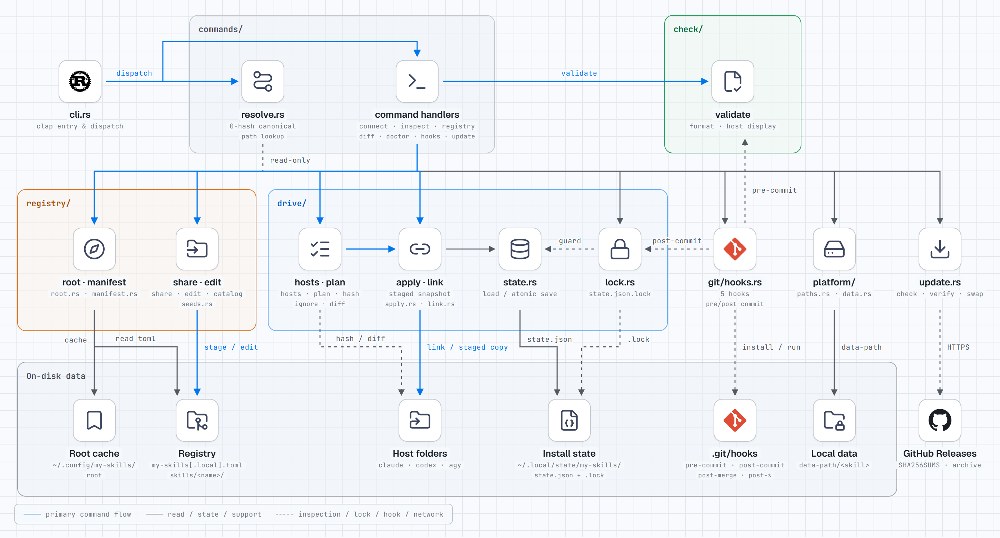

# my-skills Architecture

`my-skills` is a single Rust binary (`src/main.rs` → `src/cli.rs`) built around a clean split between the **canonical side** (`registry/`, reading and editing your skill repo) and the **connection side** (`drive/`, planning and applying links or copies into agent host folders). Command handlers in `commands/` only coordinate flow, print output, and pick exit codes (`0` ok, `1` blocked or failed check, `2` usage or configuration error). All shared checks live in `check/`, Git hook management lives in `git/`, OS path lookup lives in `platform/`, and self-update lives in `update.rs`.

## Overview

<picture>
  <source media="(prefers-color-scheme: dark)" srcset="images/architecture-dark.png">
  
</picture>

## Modules

| Path | Owns | Main entry points |
| --- | --- | --- |
| `src/cli.rs` | `clap` CLI definitions, argument structs, and subcommand dispatch. | `Cli`, `Command`, `run` |
| `src/commands/` | Per-command orchestration and output (`connect`, `inspect`, `registry`, `doctor`, `hooks`, `update`). | `connect::{install, sync, uninstall, convert, bootstrap}`, `inspect::*`, `registry::*`, `doctor::run`, `hooks::run`, `update::run` |
| `src/registry/` | Canonical repo side: root lookup, manifest + local overlay loading, comment-preserving edits, catalog output, seed scaffolding, and `import`/`share`. | `root::load_manifest_resolved`, `manifest::load_manifest`, `edit::prepare_*`, `catalog::rows`, `seeds::Scaffold`, `share::{import, share, plan_share}` |
| `src/drive/` | Host connection side: built-in host definitions, read-only planning, atomic apply/rollback, symlink/junction handling, deterministic directory hashing, ignore rules, and `state.json`. | `hosts::ALL`, `plan::{plan_install_one, plan_sync, plan_convert, status_of}`, `apply::apply`, `link::{entry_kind, create_link, remove_link}`, `hash::hash_directory`, `state::State` |
| `src/check/` | Agent Skills validation (YAML frontmatter + host rules) and security audit rules/analyzers. | `frontmatter::parse_document`, `validate::{compose_validation, validate_skill_for_host, gate_errors}`, `audit::{audit_skills, run_audit, cross_skill_findings}` |
| `src/git/` | Managed Git hook installation, status checks, and staged-index `pre-commit` validation. | `hooks::{Git, install, uninstall, status, pre_commit}` |
| `src/platform/` | Cross-platform home/config/state/data directories and Windows verbatim-path display helpers. | `paths::{home_dir, config_home, state_home, data_root, display_path}`, `data::skill_data_path` |
| `src/update.rs` | GitHub Releases lookup, `SHA256SUMS` verification, extraction, executable lock, and rollback-safe swap. | `latest_release`, `UpdateDownload::{new, install}` |
| `src/error.rs` | Crate-wide `Error` enum and `Result` alias. | `Error`, `Result` |

## Main flows

### `install` and `sync` (`src/commands/connect.rs`)
1. **Resolve root & load manifest**: `registry::root::load_manifest_resolved` checks `MY_SKILLS_ROOT`, then `my-skills.toml` in cwd/ancestors, then `~/.config/my-skills/root`. Read-only commands, `sync --check`, and `--dry-run` never write the cache; real writes cache cwd only on first-ever discovery, refuse with exit `2` when cwd differs from a saved active registry, and expose `RegistryMeta` (`{path, source}`) for JSON output. `registry::manifest::load_manifest` then merges `my-skills.toml` + `my-skills.local.toml` + CLI flags.
2. **Load state & plan**: `drive::state::State::load` reads `~/.local/state/my-skills/state.json`. `InstallRecord::belongs_to` (`src/drive/state.rs`) verifies registry ownership by comparing the canonicalized parent of `record.source` against `manifest.skills_dir()`, and `src/drive/plan.rs` marks other registries' connections `FOREIGN` / `BLOCK_FOREIGN` (silently skipping them when `plan_sync` prunes). `plan_install_one` and `plan_sync` inspect host paths via `drive::link::entry_kind` and hash copies via `drive::hash::hash_directory` without writing anything.
3. **Validate & audit**: `check::validate::{compose_validation, validate_skill_for_host}` checks `SKILL.md` and host limits; `check::audit::audit_skills` runs the policy gate unless `--skip-audit`. Both `install --dry-run` and `sync --dry-run` run these same checks before reporting (`install` validates before planning; `sync` validates and audits skills with planned creates/updates).
4. **Apply per item with rollback**: `drive::apply::apply` creates links (`drive::link::create_link`) or stages copies into sibling temp dirs and swaps them into place. After each item, it saves `state.json` atomically (`State::save` via `.tmp` + rename); if disk or state save fails, it restores the backup/previous entry and memory state.
5. **Report**: `commands/connect.rs` prints per-item outcomes and exits `1` if any item failed or was blocked (`DRIFTED`, `CONFLICT`, `UNMANAGED`, `BROKEN`, `FOREIGN`/`BLOCK_FOREIGN`). Dry runs emit a top-line `BLOCKED:` summary in text mode (plus a `--yes` hint when multi-host confirmation is needed) or UTF-8 JSON with `registry`, `dry_run`, `blocked`, `applicable`, `block_reasons`, `validation`, `audit`, and `actions`, exiting `1` only on validation failure.

### `import` and `share` (`src/commands/registry.rs` → `src/registry/share.rs`)
1. **Stage safely**: `Snapshot::new` opens the source with no-follow directory handles (`cap_std`), rejects symlinks anywhere in the tree, and copies into a staging tempdir.
2. **Validate & audit**: runs `check::validate::compose_validation` and `check::audit` against the staged snapshot, and compares hashes against any existing `skills/<name>/`.
3. **Prepare manifest edit**: `registry::edit::prepare_import` or `prepare_registration` acquires `my-skills.toml.edit-lock` and builds a comment-preserving `ManifestEdit`.
4. **Publish & commit**: `Snapshot::publish` verifies the destination does not overlap any host directory, swaps the snapshot into `skills/<name>/` (backing up any overwritten version), commits `my-skills.toml` atomically, and for `share` saves the adopted `InstallRecord` to `state.json`. Any failure rolls back both `skills/<name>/` and `my-skills.toml`.

### Git hooks (`src/commands/hooks.rs` → `src/git/hooks.rs`)
1. `my-skills hooks install` (and `hooks uninstall`) follow the real-write root policy (refusing a non-active cwd registry and caching a first-ever active root unless `--dry-run`) and write four shell wrappers (`pre-commit`, `post-merge`, `post-rewrite`, `post-checkout`) into `.git/hooks/` (skipping if foreign hooks exist). Each wrapper exports `MY_SKILLS_ROOT` for that registry and invokes `my-skills hooks run <name> "$@"`.
2. **`pre-commit`**: `hooks::pre_commit` reads staged files (`git diff --cached`), exports exact staged blobs (`git cat-file --batch`) into a temp snapshot without checkout filters, and runs `check::validate::gate_errors` on each changed skill plus manifest loading if `my-skills.toml` changed.
3. **`post-merge`, `post-rewrite`, `post-checkout`** (branch switches only, flag `1`): `commands/hooks.rs` runs `commands::connect::sync` with `--yes --quiet`, printing a warning instead of failing Git if sync reports problems (including when invoked without `MY_SKILLS_ROOT` inside a non-active clone).

### `update` (`src/commands/update.rs` → `src/update.rs`)
1. `latest_release` fetches the GitHub Releases API (`stable` picks highest non-prerelease `v1.*`; `main` picks highest semver tag) and compares against `CARGO_PKG_VERSION`.
2. `UpdateDownload::install` downloads `SHA256SUMS` and the platform archive, checks the SHA-256 digest, and extracts the binary into a temp directory beside the current executable.
3. `replace` locks `<exe>.update-lock`, confirms the installed binary still matches `CURRENT_VERSION`, backs up the current executable, renames the staged binary into place, and verifies `--version` — restoring the backup if anything fails.

## Where to start

- **Add a built-in host**: add a `HostConfig` constant and register it in `ALL` in `src/drive/hosts.rs`, update the default manifest template and `SEED_HOSTS` in `src/registry/seeds.rs`, and add host-specific diagnostics in `src/commands/doctor.rs` if needed.
- **Add a security audit rule**: declare the rule ID, category, and severity in `src/check/audit/builtin_rules.yaml`, then emit `rules::finding(...)` from the relevant analyzer (`static_checks.rs`, `structure.rs`, `markdown.rs`, `commands.rs`, `analyzers.rs`, or `bundle.rs`).
- **Add a CLI command**: add the subcommand and args struct in `src/cli.rs`, wire `cli::run` to a handler in `src/commands/` (keeping business logic in `registry/`, `drive/`, `check/`, or `git/`), and add integration tests under `tests/`.
