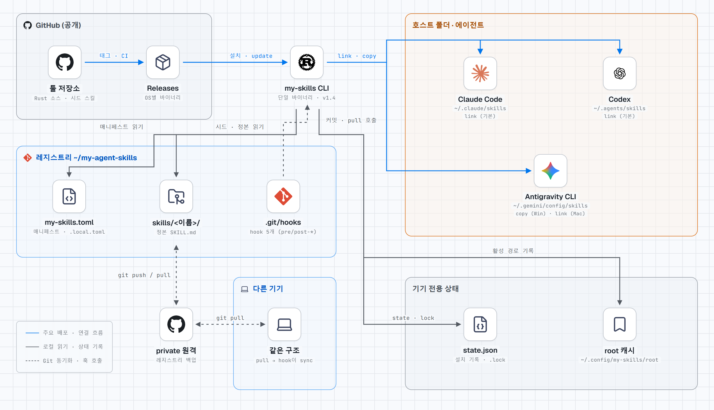
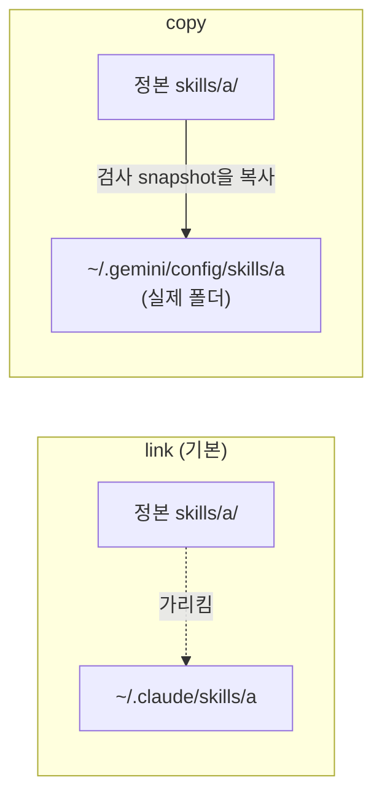
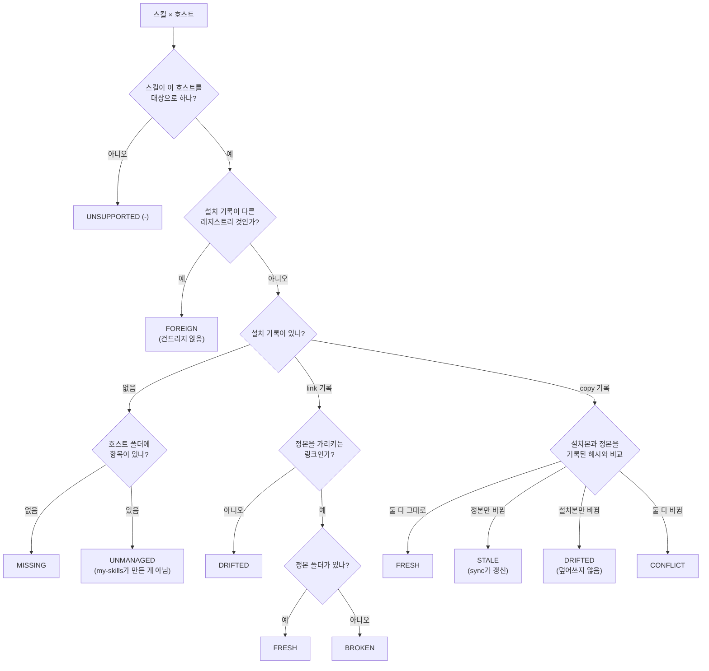
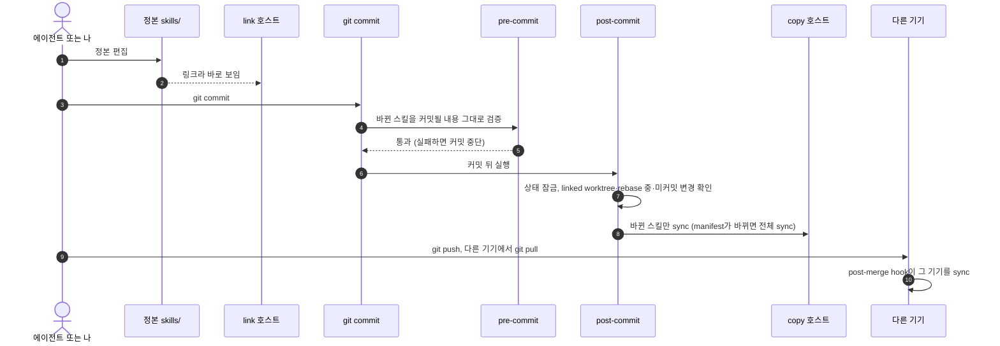
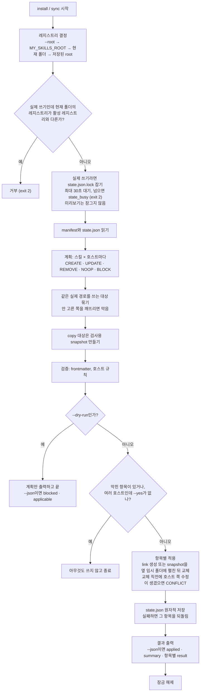
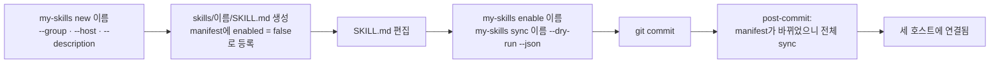
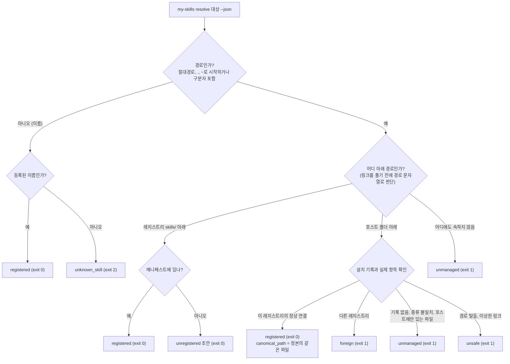
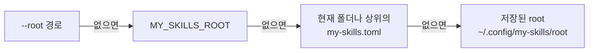
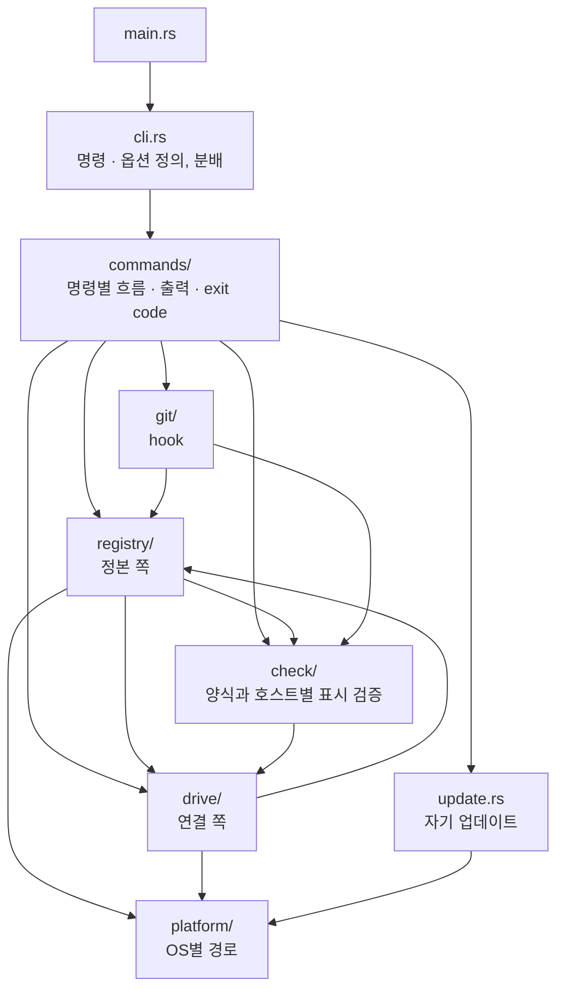
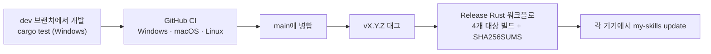

# my-skills 시스템 지도

이 문서는 my-skills가 **무엇을 어디에 두고, 어떤 순서로 움직이며, 코드의 어느 파일이 그 일을 하는지**를 그림으로 정리한다. 기준은 v1.3.0이다.

- 명령과 옵션의 세부 동작은 [reference.md](reference.md)에 있다.
- 개발자용 모듈 설명(영어)은 [architecture.md](architecture.md)에 있다.

**한 줄 요약:** 스킬 원본은 레지스트리 한 곳(`~/my-agent-skills/skills/`)에만 있다. my-skills CLI는 그 원본을 Claude Code, Codex, Antigravity CLI(agy)가 읽는 폴더에 **link**(가리키기)나 **copy**(복사)로 연결한다. 무엇을 어떻게 연결했는지는 기기마다 `state.json`에 적어 둔다.

---

## 1. 용어

| 용어 | 뜻 |
| --- | --- |
| **툴 저장소** (tool repo) | GitHub의 `Seosiju/my-skills` 공개 저장소. CLI의 Rust 소스와 시드 스킬이 있다. 사용자의 스킬을 두는 곳이 아니다. |
| **CLI** | 설치된 `my-skills` 실행 파일 하나. GitHub Releases에서 받고, `my-skills update`로 올린다. |
| **시드 스킬** | 툴 저장소 `skills/`에 있는 기본 스킬 세 개(`my-skills`, `cli-inventory`, `my-jira`). 바이너리 안에 들어 있다. `init-registry`가 새 레지스트리를 만들 때 처음 한 번 복사한다. `my-skills` 시드는 에이전트에게 CLI 사용법을 가르치는 안내서다. |
| **레지스트리** (registry) | 사용자의 스킬 저장소. 기본 위치는 `~/my-agent-skills`이고, 보통 private Git 저장소다. |
| **정본** (canonical) | 레지스트리의 `skills/<이름>/`. 스킬을 고칠 때는 항상 여기를 고친다. |
| **매니페스트** | 레지스트리의 `my-skills.toml`이다. 등록된 스킬, 켜짐/꺼짐, 그룹, 대상 호스트, 연결 방식을 적는다. 기기마다 다른 설정은 Git에서 빠지는 `my-skills.local.toml`에 둔다. |
| **호스트** (host) | 스킬을 읽는 에이전트. `claude`, `codex`, `agy` 세 개다. |
| **호스트 폴더** | 각 에이전트가 스킬을 찾는 폴더. `~/.claude/skills`, `~/.agents/skills`, `~/.gemini/config/skills`다. |
| **연결** (connection) | 정본과 호스트 폴더를 잇는 것. 스킬 하나와 호스트 하나마다 연결이 하나 생긴다. |
| **link** | 호스트 폴더의 항목이 정본을 가리킨다(macOS는 symlink, Windows는 junction). 정본을 고치면 바로 보인다. 기본 방식이다. |
| **copy** | 정본을 호스트 폴더에 복사한다. 정본을 고친 뒤 sync해야 반영된다. Windows의 agy는 junction을 찾지 못해서 copy를 쓴다. |
| **state.json** | 기기마다 있는 설치 기록. 어느 연결을 언제, 어떤 해시로 만들었는지 적는다. |
| **활성 레지스트리** | CLI가 기본으로 쓰는 레지스트리. 경로를 `~/.config/my-skills/root`에 저장한다. |
| **hook** | 레지스트리 `.git/hooks`에 설치되는 스크립트 다섯 개. 커밋하거나 pull할 때 CLI를 부른다. |
| **검증** (validate) | 스킬이 호스트마다 어떻게 보이는지 경고로 알려 준다. `SKILL.md`가 없으면 차단한다. |
| **그룹** | 매니페스트의 `group = "이름"`. 명령에 `--group 이름`을 주면 그룹의 스킬을 한꺼번에 고른다. |

---

## 2. 전체 그림

<picture>
  <source media="(prefers-color-scheme: dark)" srcset="images/system-map-overview-dark.png">
  
</picture>

세 가지만 기억하면 된다.

1. **원본은 레지스트리 하나뿐이다.** 호스트 폴더는 그 원본으로 가는 연결일 뿐이니 직접 고치지 않는다.
2. **CLI는 연결을 관리한다.** 무엇을 연결할지는 매니페스트를 보고 정한다. 무엇을 연결했는지는 `state.json`에 적는다.
3. **Git이 기기 사이를 잇는다.** 레지스트리를 push하고 다른 기기에서 pull하면, 그 기기의 hook이 그 기기의 호스트를 맞춘다.

---

## 3. 디스크 지도

```text
툴 저장소 (GitHub, 개발할 때만 clone)
└── my-skills/
    ├── src/                      ← CLI 소스 (6장)
    ├── skills/                   ← 시드 스킬 3개 (바이너리에 들어감)
    ├── tests/                    ← 통합 테스트 37개 파일
    └── docs/

레지스트리 (내 스킬, private Git)
└── ~/my-agent-skills/
    ├── my-skills.toml            ← 등록·켜짐·그룹·호스트·연결 방식
    ├── my-skills.local.toml      ← 이 기기만의 재정의 (Git 제외)
    ├── my-skills.toml.edit-lock  ← manifest를 고치는 동안만 생김
    ├── AGENTS.md                 ← 이 레지스트리의 운영 규칙 (에이전트가 읽음)
    ├── instructions/global.md    ← 세 에이전트 전역 안내의 원본
    ├── skills/<이름>/SKILL.md    ← 정본
    └── .git/hooks/               ← pre-commit, post-commit, post-merge, post-rewrite, post-checkout

호스트 폴더 (에이전트가 읽는 곳)
├── ~/.claude/skills/<이름>       ← link (또는 copy)
├── ~/.agents/skills/<이름>       ← Codex
└── ~/.gemini/config/skills/<이름> ← agy (Windows는 copy)

기기 전용 상태 (Git에 안 올라감)
├── ~/.local/state/my-skills/state.json       ← 설치 기록
├── ~/.local/state/my-skills/state.json.lock  ← 쓰기 잠금 파일 (지우지 않음)
├── ~/.config/my-skills/root                  ← 활성 레지스트리 경로
├── ~/.config/my-skills/root.lock
└── 스킬별 데이터 (my-skills data-path <이름>)
    ├── Windows: %LOCALAPPDATA%\my-skills\data\<이름>
    └── macOS·Linux: ~/.local/share/my-skills/<이름>
```

비밀번호나 계정 설정처럼 Git에 올리면 안 되는 것은 마지막 칸의 스킬별 데이터 폴더에 둔다.

---

## 4. 연결 방식과 상태

### link와 copy



- **link:** 정본을 고치는 순간 에이전트에게 보인다. sync가 필요 없다.
- **copy:** 복사한 시점의 내용이 남는다. 정본이 바뀌면 STALE이 되고, sync나 post-commit hook이 다시 복사한다. 누가 호스트 쪽 복사본을 직접 고쳤다면 DRIFTED가 되고, 그 수정은 덮어쓰지 않는다.
- **연결 방식 우선순위:** 명령의 `--mode`, `my-skills.local.toml`의 `[targets.<호스트>] install_mode`, `my-skills.toml`의 같은 항목, `[defaults] install_mode` 순으로 앞의 것이 이긴다. link를 만들 수 없으면 copy로 바꾸고 그 이유를 기록한다.

### 상태는 이렇게 정해진다

`my-skills status`와 `skills --json`이 보여 주는 값이다. 연결 하나마다 다음 순서로 판정한다.



판정 코드는 `src/drive/plan.rs`의 `status_of`에 있다.

---

## 5. 흐름

### 5.1 스킬을 고치고 커밋할 때 (가장 흔한 일)



- Git 레지스트리라면 커밋 뒤에 따로 부를 명령이 없다.
- Git을 쓰지 않으면 `my-skills sync <스킬> --json` 한 번으로 반영한다.
- **post-commit이 아무것도 하지 않는 경우:**
  - linked worktree에서 커밋했다.
  - rebase, merge, cherry-pick이 진행 중이다.
  - `my-skills.toml`에 커밋하지 않은 변경이 있다.
- **post-commit이 건너뛰는 스킬:** 커밋하지 않은 수정이 남은 스킬은 경고만 하고 건너뛴다.
- post-commit은 항상 성공(exit 0)으로 끝나서 커밋을 막지 않는다.
- 코드: `src/commands/hooks.rs`(실행), `src/git/hooks.rs`(판단과 pre-commit 검증).

### 5.2 `install` / `sync` 안에서 일어나는 일



- **미리보기와 적용:** 미리보기는 항상 `--dry-run --json`이다. 적용할 때는 `--dry-run`만 빼면 된다.
- **명시 `sync`의 검사 범위:** `sync <스킬>`이나 `--group`처럼 대상을 명시하면, 그대로 연결될 스킬은 이미 FRESH인 link라도 검증한다. 꺼져서 제거만 남은 스킬은 검사하지 않고 연결만 정리한다.
- **인자 없는 `sync`:** hook이 쓰는 방식이다. 바뀔 항목만 검사한다.
- 코드: `src/commands/connect.rs`(흐름), `src/drive/plan.rs`(계획), `src/drive/apply.rs`(적용과 되돌림), `src/drive/lock.rs`(잠금), `src/drive/state.rs`(기록).

### 5.3 새 스킬 만들기



- `new`는 다음 경우에 쓰기 전에 멈춘다.
  - 이름이 규칙에 맞지 않는다.
  - 같은 이름의 폴더가 있거나 이미 등록되어 있다.
  - 호스트 이름을 모른다.
  - 설명이 비어 있다.
- 설명이 길면 원문 전체를 저장하고 대상별 잘림을 경고한다. Codex는 공백을 정리한 설명 1,024자, Claude Code는 설명과 `when_to_use`를 합쳐 1,536자가 기준이다.
- 등록에 실패하면 자기가 만든 파일만 지운다.
- 코드: `src/commands/registry.rs`의 `new_skill`, `src/registry/edit.rs`.

### 5.4 정본 찾기 (`resolve`)

에이전트가 어떤 경로를 보고 있을 때, 고쳐야 할 정본 파일이 어디인지 한 번에 알려 준다. 파일을 해시하지 않아서 빠르다.



- link 호스트에서 보이는 경로는 이미 정본과 같다. 그래서 대개 `resolve`가 필요 없다.
- copy 호스트, 하위 파일, 확실하지 않은 경로일 때 한 번 부른다.
- 코드: `src/commands/resolve.rs`.

### 5.5 어느 레지스트리를 쓰는가



- 앞에 있는 것이 이긴다.
- 읽기 명령과 `--dry-run`은 저장된 root를 바꾸지 않는다.
- 현재 폴더의 레지스트리가 활성 레지스트리와 다르면, 실제 쓰기는 거부한다.
  - 예: 툴 저장소 안에서 실행한 경우. 그 폴더의 `my-skills.toml`은 테스트용이다.
- 코드: `src/registry/root.rs`.

---

## 6. 코드 구조

### 6.1 모듈 관계



**규칙.** `commands/`는 흐름과 출력만 맡는다. 실제 일은 아래 모듈이 한다.
- `registry/`는 레지스트리(정본, manifest)를 다룬다.
- `drive/`는 호스트 폴더와 `state.json`을 다룬다.
- `check/`는 스킬 내용을 검사만 하고 아무것도 쓰지 않는다.

### 6.2 명령 → 파일

| 명령 | 흐름 (commands/) | 실제 일을 하는 곳 |
| --- | --- | --- |
| `install`, `sync`, `uninstall`, `convert`, `bootstrap` | `connect.rs` | `drive/plan.rs`, `drive/apply.rs`, `drive/lock.rs`, `drive/state.rs`, `check/` |
| `status`, `validate`, `set-root`, `data-path` | `inspect.rs` | `drive/plan.rs`, `check/`, `registry/root.rs`, `platform/data.rs` |
| `skills`, `enable`, `disable`, `share`, `import`, `init-registry`, `new` | `registry.rs` | `registry/catalog.rs`, `registry/edit.rs`, `registry/share.rs`, `registry/seeds.rs` |
| `resolve` | `resolve.rs` | `drive/state.rs`, `drive/link.rs`, `registry/root.rs` |
| `diff` | `diff.rs` | `drive/diff.rs`, `drive/plan.rs` |
| `doctor` | `doctor.rs` | `registry/catalog.rs`, `git/hooks.rs`, `drive/` |
| `hooks install/status/uninstall/run` | `hooks.rs` | `git/hooks.rs`, 그리고 sync를 위해 `connect.rs` |
| `update` | `update.rs` | `src/update.rs` |

### 6.3 파일별 역할

| 폴더 | 파일 | 역할 |
| --- | --- | --- |
| `registry/` | `root.rs` | 어느 레지스트리를 쓸지 정하고(5.5), 활성 레지스트리를 저장하고, 쓰기 거부를 판단한다 |
| | `manifest.rs` | `my-skills.toml`과 `.local.toml`을 합쳐 읽는다. 스킬 이름과 `--group`을 실제 목록으로 바꾼다(`select_names`) |
| | `edit.rs` | 주석을 지키면서 manifest를 고친다(enable/disable/등록). 편집 잠금을 건다 |
| | `catalog.rs` | `skills` 목록 행과 doctor의 `Catalog:`(설명 글자 수) 계산 |
| | `seeds.rs` | 시드 스킬과 `init-registry` 템플릿 |
| | `share.rs` | 호스트에만 있는 스킬을 정본으로 가져오기(`share`), 외부 폴더 들이기(`import`) |
| `drive/` | `hosts.rs` | 세 호스트의 기본 경로, 설명 한도, 재시작 안내 |
| | `plan.rs` | 쓰지 않고 계획만 세운다. 상태 판정(4장), 같은 경로 묶기 |
| | `apply.rs` | 계획을 실제로 적용한다. 임시 폴더에 준비한 뒤 바꿔 끼우고, 실패하면 되돌린다. 정리 실패는 경고로 처리한다 |
| | `link.rs` | symlink·junction 만들기와 읽기, 관리 링크 판별 |
| | `state.rs` | `state.json` 읽기·쓰기, 이 레지스트리의 기록인지 판별(`belongs_to`) |
| | `lock.rs` | `state.json.lock` 쓰기 잠금 |
| | `hash.rs`, `ignore.rs` | 폴더 해시(`.git`, `__pycache__`, `.DS_Store` 등은 제외) |
| | `diff.rs` | 정본과 호스트 복사본의 파일 단위 비교 |
| `check/` | `frontmatter.rs` | SKILL.md 머리말(YAML) 해석 |
| | `validate.rs` | 형식과 호스트 규칙 검증. pre-commit과 `validate`가 같은 판정을 쓴다 |
| `git/` | `hooks.rs` | hook 설치·상태 확인, pre-commit 검증, post-commit에서 무엇을 sync할지 판단 |
| `platform/` | `paths.rs`, `data.rs` | 홈·설정·상태·데이터 폴더 위치, Windows 경로 표시 |
| (루트) | `update.rs` | GitHub Releases에서 받아 SHA-256을 확인하고 실행 파일을 교체한다 |

---

## 7. 안전장치 한눈에

| 막는 사고 | 장치 | 위치 |
| --- | --- | --- |
| 에이전트 둘이 동시에 쓰다가 설치 기록이 사라짐 | 쓰기 명령 전체를 `state.json.lock` 하나로 줄 세움 | `drive/lock.rs` |
| 검사한 내용과 복사한 내용이 다름 | copy는 검사 snapshot 하나로 검증·복사·해시 | `drive/apply.rs`, `commands/connect.rs` |
| 호스트에서 직접 고친 내용을 덮어씀 | DRIFTED·CONFLICT면 덮어쓰지 않음. 교체 직전에 다시 해시 | `drive/plan.rs`, `drive/apply.rs` |
| 다른 레지스트리의 연결을 지움 | 설치 기록의 출처로 소유를 확인(FOREIGN) | `drive/state.rs` |
| 테스트용 저장소에 실수로 씀 | 활성 레지스트리가 아니면 쓰기 거부 | `registry/root.rs` |
| `SKILL.md`가 빠진 스킬이 퍼짐 | 검증에서 차단한다. 커밋 때는 pre-commit에서 검사한다. | `check/`, `git/hooks.rs` |
| 한 호스트만 바꾸다 경로를 같이 쓰는 다른 호스트를 깨뜨림 | 공유 대상 검사(`shared_destination`) | `drive/plan.rs` |
| hook이 엉뚱한 상태에서 sync | worktree·rebase 중·미커밋 변경이면 hook이 쉼 | `git/hooks.rs`, `commands/hooks.rs` |
| 업데이트 중 실행 파일이 망가짐 | 체크섬 확인, 백업 후 교체, 실패하면 복구 | `update.rs` |

---

## 8. 테스트와 배포



- **통합 테스트:** `tests/`에 37개 파일이 있다. 실제 사용자 폴더를 건드리지 않도록, 테스트마다 HOME·XDG·LOCALAPPDATA를 임시 폴더로 바꿔서 돌린다.
- **릴리스 절차:** `docs/release-checklist.md`
- **GitHub 워크플로:** `.github/workflows/ci.yml`, `.github/workflows/release-rust.yml`
